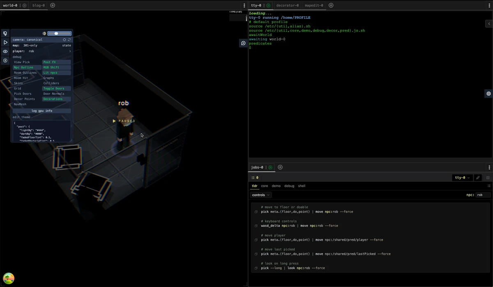

# NPC CLI

<!-- pnpm sync-readme writes this from packages/app/src/components/about.mdx: edit that instead -->

Hey there, I'm Rob Myers
and this is SCP NPC-CLI.

- [me.robmyers@gmail.com](mailto:me.robmyers@gmail.com)
- [rob-myers/npc-cli-vite](https://github.com/rob-myers/npc-cli-vite)

## Features

- **World**: 3D in three.js WebGPU, on [Starship Geomorphs](https://travellerrpgblog.blogspot.com/2020/07/starship-geomorphs-20.html).
- **Jsh**: a bash-like JavaScript shell.
- **Npcs**: walk, open doors, sit, talk and shoot.
- **SkipNet**: articles with runnable commands.
- **MapEdit**: an SVG map editor.
- **Decorator**: places decor live.
- **Multiplayer** over WebRTC.
- **Touch** on a phone.

## Screenshots

*Moving the player and spawning npcs in Geomorph 301*

Built with three.js, React Three Fiber, Navcat, Mvdan/sh, Xterm.js and Vite.
Maps are made in MapEdit (inspired by Boxy SVG).

## Notices and licenses

### Starship Geomorphs

Starship Geomorphs v2.0 is Copyright © 2020 by Pearce Design Studio, LLC and is licensed under a Creative Commons Attribution Non-Commercial 4.0 International License.

The Traveller game in all forms is owned by Far Future Enterprises. Copyright 1977-2020 Far Future Enterprises. Traveller is a registered trademark of Far Future Enterprises. Far Future permits web sites and fanzines for this game, provided it contains this notice, that Far Future is notified, and subject to a withdrawal of permission on a 90 days notice. The contents of this page are for personal, non-commercial use only. Any use of Far Future Enterprises's copyrighted material or trademarks anywhere in these documents should not be viewed as a challenge to those copyrights or trademark.

### PNG Extractions

This work is Copyright © 2020 by Eric B. Smith and is licensed under a Creative Commons Attribution Non-Commercial 4.0 International License.

[CC BY-NC 4.0](https://creativecommons.org/licenses/by-nc/4.0/)

### SCP Foundation

Content relating to the SCP Foundation, including the SCP Foundation logo, is licensed under Creative Commons Sharealike 3.0 and all concepts originate from [scp-wiki.wikidot.com](https://scp-wiki.wikidot.com) and its authors.

[CC BY-SA 3.0](https://creativecommons.org/licenses/by-sa/3.0/)

### NPC CLI

The code is Copyright © 2025-2026 by Robert S. R. Myers and is licensed under the [MIT License](https://github.com/rob-myers/npc-cli-vite/blob/main/LICENSE). The assets above keep their own licenses.
