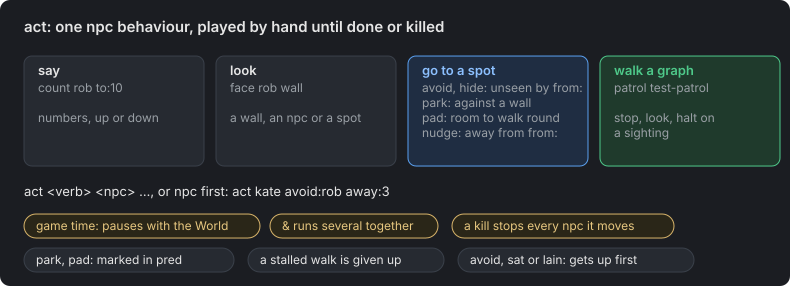
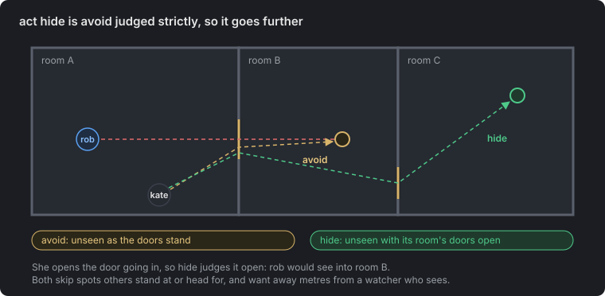

# Acts: jsh `act`

Npc behaviours on the spots about them, played by hand. `act <verb> <npc> …` (`cli/src/jsh/world/act.ts`) runs one on game time until done or killed. Run several as background jobs (`&`) to compose them. `from` names npcs, comma-separated. `rooms` limits the spots, else the whole map.

Npc first, a verb takes its main option as `<verb>:<value>`: `act kate avoid:rob` is `act avoid kate from:rob`, as are `hide:rob` (`from:rob`), `nudge:rob` (`from:rob`), `face:g0r12-3` and `count:10` (`to:10`). Other options follow, e.g. `act kate avoid:rob away:3`. `park` and `pad` take several npcs, comma-separated, planned together: `act park rob,kate`.

| Verb | Does |
| --- | --- |
| `count rob [from:1] [to:10] [every:1] [down]` | Says each number from `from` to `to`, either way. `from:3` alone counts down to 1, as does `down` from `to` |
| `face rob wall` | Looks towards their spot's nearest occluder. Also an npc or a spot key |
| `hide cal from:rob [away:6] [prefer:cover,corner]` | As `avoid`, judged strictly: every spot it will count as at must be unseen, with its room's doors open, as it opens one going in and may stand by one. So it goes further than `avoid` |
| `avoid cal from:rob [away:6] [prefer:cover,corner]` | To a spot none of them sees, `away` metres from them if one is, judged by that spot alone. Skips spots others stand at or head for. Already unseen, it stays put. Sat or lain, it first gets up beside its seat or bed. Blocked, it tries another, failing after 3. Seen on arrival, it fails saying why, e.g. which of its spots may be seen |
| `park rob,kate` | Against a nearby wall, clear of its corners, the room's doorways and others parked: they walk there, then face out. Marked parked (`pred.ts`). One with no clear spot stays put, and one blocked on the way stops: both are named in the error, e.g. `not parked: kate, rob blocked` |
| `pad kate rob [by:1]`, `pad kate rob walls:0.3 npcs:1` | Where there is room to walk right round them: `walls` metres from walls and doorways, `npcs` from others. `by` is `npcs`. Each defaults to `standConfig.padClearance`: 0.3 from walls, 0.6 from others. They walk there, and are marked padded with it. Those padded with at least as much room stay put, else they are padded again. One with no room, or blocked on the way, is named in the error, e.g. `not padded: kate, rob blocked` |
| `patrol test-patrol [npc:guard-0] [npcs:$( [] g1 g2 )] [watch:$( [] rob kate )] [say:Stop!] [secs:2] [lookSecs:2] [lookDeg:60]` | Walks a graph until killed, stopping at each node to look either side, else `path:<points>` or `cycle:<points>`. See Patrolling in `docs/graphs.md` |
| `nudge kate [from:rob] [by:0.5]` | Walks `by` metres away from `from`, an npc or a point, else a random way, slid along the navmesh so a wall or a door they cannot pass stops them |

A walk that stalls, e.g. blocked by the player, is given up.

An act pauses with the World, as any world command (`docs/jsh-pause.md`). Paused by hand or by the Jsh pane, the npc stops, and walks or looks on once resumed. Its waits count only whilst it runs, through its `Task` (`docs/tasks.md`). A kill stops every npc it moves.

`sees` asks who sees whom: see `docs/perception.md`.
