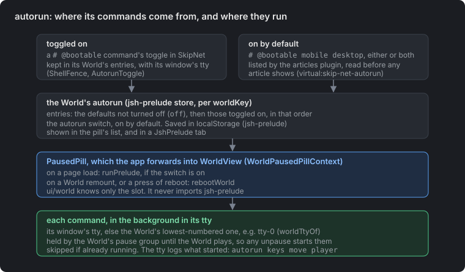
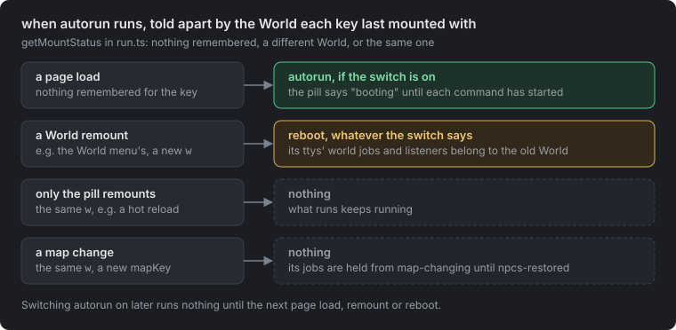
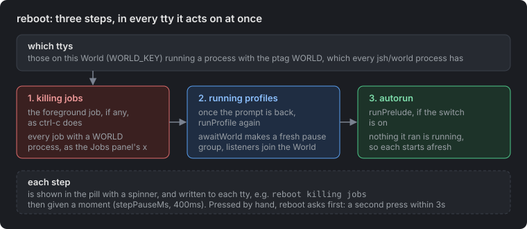

# Autorun

**Autorun** runs jsh commands when a World loads. The commands come from SkipNet articles, and each one runs in the background in a tty.

- The **autorun switch** in the paused pill turns it on or off for each World. It is on by default.
- **Reboot** re-runs everything jsh does for a World: it kills the World's jobs, runs the ttys' profiles again, then runs autorun.

The code is in `packages/ui/jsh-prelude` (`@npc-cli/ui__jsh-prelude`). In the code, a World's list of autorun commands is called its **prelude**.



## Marking a command

To make a command available to autorun, add a `# @bootable` line to its comment in a SkipNet article. The line is hidden when the fence is shown.

```sh
# pointer moves player
# @bootable @default
pick meta.{floor,do} | move $( playerPath ) --force
```

Every marked command gets a toggle, a lightning bolt on the right of the command. An `@default` word after `@bootable` makes it start on:

| Marker | The command |
| --- | --- |
| `# @bootable` | Off until you toggle it on |
| `# @bootable @default` | On by default, on mobile and desktop |
| `# @bootable @default=desktop` | On by default on a desktop |
| `# @bootable @default=mobile` | On by default on a touch device |

The words after `@bootable` are `@key` or `@key=value`, and `@default` is the only one read so far. A touch device is one with touch events or touch points (`isTouchDevice` in `@npc-cli/util/legacy/dom`), checked once as the page loads (`defaults.ts`).

A command that is on by default is called a **default**. It stays on until you toggle it off.

- **Toggling a command on** adds it to the autorun of the SkipNet panel's World (`meta.worldKey`). It will run in the article window's tty.
- **The order** is the defaults first, then the commands you toggled on, in the order you toggled them.
- **Toggling a default off** records it in the World's `off` list. Toggling it on again removes it from that list.
- **Each entry keeps its own copy of the command.** Its id comes from its fence (`{articleKey}#{fenceHash}/{index}`). If you edit the fence, the id changes and the toggle shows off, but the old copy stays in the list until you remove it. Ids in `off` that are no longer defaults are dropped the next time a default is turned off.

### How defaults are found

Autorun runs before any article has been opened, so it cannot learn the defaults from the article windows.

- The articles plugin (`vite-plugin-skip-net-articles`) reads every article. It provides each fence that has an `@default` marker as the module `virtual:skip-net-autorun`.
- `defaults.ts` splits those fences into commands with the same parser the fences use (`splitExamples` and `fenceIdOf` in `@npc-cli/cli`), so the ids match the toggles' ids.
- Editing an article's markers updates the defaults straight away. Editing the plugin itself needs a dev server restart.

## When it runs



The paused pill decides what to do when it mounts. It compares the World object with the one its `worldKey` last mounted with (`getMountStatus` in `run.ts`):

- **A page load.** No World was remembered. Autorun runs if the switch is on, and the pill says "booting" until every command has started.
- **A World remount**, e.g. from the World menu. The World object is new. A reboot runs, whether or not the switch is on, because the ttys' jobs and the profiles' listeners still belong to the old World.
- **Only the pill remounts.** The World object is the same, so nothing happens.
- **A map change** keeps the same World object, so nothing happens. Autorun's jobs pause from `map-changing` until `npcs-restored`, as every world job does (`docs/jsh-pause.md`).

The World is paused while it loads, so autorun's world commands start paused by the World's pause group. Any way of unpausing starts them: the pill, Enter, the menu, or jsh `play`.

If you switch autorun on after the page has loaded, nothing runs until the next page load, remount or reboot.

The remembered World objects are kept in a `Map` outside React, because a World remount also remounts its pill. A hot reload of `run.ts` empties the `Map`. The next remount is then treated as a page load: autorun runs, and skips any command that is still running.

## Which tty

- **A command toggled on in a window with a tty** runs in that tty.
- **A default, or a command toggled on in a window without a tty,** runs in the World's lowest-numbered tty, e.g. `tty-0` (`worldTtyOf`). A World can have several ttys with its `WORLD_KEY`, so this rule picks one.
- **If the tty isn't mounted yet,** it is mounted offscreen (`markEverSeen`), and autorun waits for its profile to finish.
- **If the same command is already running** in that tty, it is skipped (`isRunning`). Commands are compared by their exact source.

Each tty prints one line listing what autorun started there, in the same style as `loaded map`:

```
autorun pointer moves player, keys move player
```

The autorun list shows each command's tty. If that tty has been closed, it shows in red, e.g. `tty-3 (gone)`. If the World has no tty at all, it shows `no tty` in red. The toggle's tooltip says where the command will run, e.g. "autoruns in tty-0".

## Reboot



`rebootWorld(worldKey, onStep)` in `run.ts` acts on every tty that belongs to the World (`WORLD_KEY`) and is running a process with the ptag `WORLD`. Every jsh/world process has that ptag, including those that opt out of World pauses (`docs/jsh-pause.md`).

The three steps run in all of those ttys at once:

1. **killing jobs**: kills the foreground job, if there is one (`killSessionLeader`, like ctrl-c). Then kills every job that has a `WORLD` process (`sessionApi.kill`, like the Jobs panel's x).
2. **running profiles**: waits for the prompt, then runs the tty's profile again (`ttyShell.runProfile`). Its `awaitWorld` creates a new pause group, and the profile's listeners attach to the current World.
3. **autorun**: runs autorun (`runPrelude`), if the switch is on.

Each step shows in the pill with a spinner, and is printed in each tty, e.g. `reboot killing jobs`. After each step there is a short pause (`stepPauseMs`, 400ms) so you can see it.

Pressing reboot yourself asks for confirmation: the button shows "confirm", and a second press within 3s reboots. A reboot after a remount doesn't ask.

## The paused pill

The app passes `PausedPill` to every World through `WorldPausedPillContext` (`ui/world/src/paused-pill.ts`), in `app/src/routes/index.tsx`. `WorldView` shows it instead of its own pill. This slot is the only part of autorun that ui/world knows about.

`WorldView` gives the pill `resumeProps` for its resume button. With them, a tap resumes the World, and a pinch or wheel over the pill still moves the camera.

- The pill says "loading" while the map loads, and "paused" when the World can be resumed. While autorun or a reboot runs, it shows a spinner with "booting" or the reboot's current step. Only "paused" responds to a tap.
- Its chevron opens a row underneath, which is closed by default. The row holds the autorun switch, the list of commands (in a modal), and the reboot button.

## Package

`packages/ui/jsh-prelude` (`@npc-cli/ui__jsh-prelude`):

| Export | What it holds |
| --- | --- |
| `./store` | `preludeStore` (zustand, saved in localStorage as `jsh-prelude`). `byWorld[worldKey]` is `{ autorun, entries, off }`. `preludeApi.entries` and `usePrelude` return the defaults that aren't off, then the commands toggled on |
| `./run` | `runPrelude`, `rebootWorld`, `getMountStatus`, `worldTtyOf`, and `isRunning`, which SkipNet's own runner also uses |
| `./paused-pill` | `PausedPill`. Its row is `WorldPrelude`, and its list is `PreludeEntries` |
| `.` | The `JshPrelude` ui, a tab that shows one World's autorun (`meta.worldKey`) |

Only the app and SkipNet import this package, and SkipNet only imports `./store` and `./run`. ui/world never imports it.
