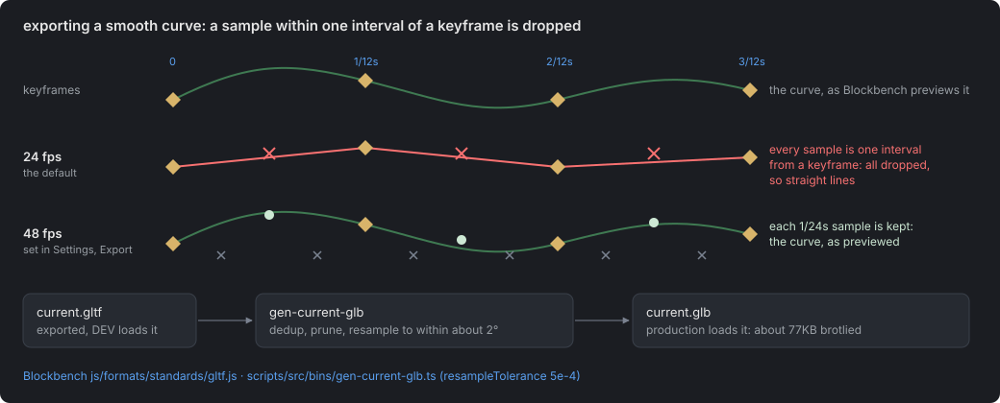

# Blockbench

Npc models are made in Blockbench, which Claude Code can drive through an MCP plugin:

- https://github.com/jasonjgardner/blockbench-mcp-plugin
- plugin script: https://jasonjgardner.github.io/blockbench-mcp-plugin/mcp.js
- in VSCode Claude Code, `/mcp` — possibly reconnect

## Tips

- Can select a model face.
- Can drag a UV square area (not diagonally).
- Select two objects, then Cmd+Drag to create a box, e.g. of vertices.
- `z` toggles wireframe.
- RMB translates the view.
- Import GLTF seems to cache the file unless you close it and choose it again.
- Personal keybinding: Shift+P for the perspective camera.

## Exporting

The model is `packages/media/src/blockbench/current/current.bbmodel`. Export it as glTF to `current.gltf` beside it: ascii, embedded textures, armature, animations.
- **Animation Sample Rate is 48** (Settings, Export). A smooth (catmullrom) curve is sampled at that rate, but the exporter drops any sample within one interval of a keyframe. Many clips have keyframes every 1/12s, so at the default 24 nearly every sample is dropped, and the curve becomes straight lines. At 48 every 1/24s sample is kept, and each clip plays as Blockbench previews it.
- A DEV World loads `current.gltf`, and refetches it on each export (`docs/mcp.md`).
- The dev server, and the pre-commit hook, write `current.glb` from it (`gen-current-glb`), which production loads. It is deduped, pruned and resampled: a keyframe its neighbours' line matches to within about 2° goes (`resampleTolerance`, 5e-4). That keeps it smaller than a 24 export's, about 77KB brotlied.
- Compare sizes with `pnpm compare-brotli packages/media/src/blockbench/current/current.glb`.

## A new clip

1. Make it in Blockbench and export, as above. Name it as the World will, e.g. `talk_left`, without Blockbench's `animation.` prefix.
2. Add it to `fromAnimationClipKey` in `const.npc.ts`, and to the fade table below it (`{}` for the default fade).
3. An upper clip over one arm, e.g. `point` or `talk_left`, is posed by jsh `pose rob as:talk_left` once it is in `poseConfig.poses`, with its arm (`side`) and the clip it draws in to near others (`avoid`, else `null`). Only a right arm's pose aims at whom it is `at`.
4. A clip that mirrors another, e.g. a left-handed take, is not made in Blockbench. It goes in `fromAnimationClipKey` and the fade table as usual, and in `mirroredClips` by the clip it mirrors (see Mirrored clips).

`talk_left` is the left arm talking: a 2.4s loop of the forearm raised and beating, with an open gesture midway. It moves `leftarm` and `leftforearm` alone, so it plays beside a right arm's pose.

## Mirrored clips

Some clips are made at load by mirroring another, so they are in neither the `.bbmodel` nor the glTF. `mirroredClips` in `const.npc.ts` lists each by the clip it mirrors, and `NPCs` builds them with `mirrorClip` (`service/clips.ts`).

- **How.** Left and right bones' tracks swap, rotations' `y` and `z` are negated, and positions' `x`. That is exact only because the rig rests unrotated and symmetric: keep it so.
- **Which.** The left or right take of a symmetric clip: `crouch_left`, `drop_left`, `pick_up_left`, `lie_right`, `pain_arm_right`, `pain_leg_right`, and the left crouch strafes. Each matched its old Blockbench take to 0°. Also each death's mirror, `die_back_mirror` and `die_forward_mirror`, which a death plays at random, and each get-up's, `get_up_back_mirror` and `get_up_forward_mirror`.
- **Editing one.** Edit the clip it mirrors: its mirror follows on the next export. Never make the mirror in Blockbench too, as the made one replaces it.
- **Not for** clips whose sides differ on purpose, e.g. `strafe_*`, `shuffle_step_*` and `run_strafe_*`, whose lead foot or timing differs. Nor for one holding something in a hand: the item stays in the right hand whilst the arms swap.
- `gen-clip-keys` writes only the right crouch strafes. Their left ones are mirrored at load.

## The run

`run` is a `0.752` s loop covering `gaitStride.run` (2.23 m) a cycle. Its legs were solved, not keyed by hand, so a planted foot never slides. One model pixel is about `0.053` m in game.

- **Timing.** Each foot is planted `5/24` of a cycle, the right from `12/24` to `17/24`, with `7/24` of flight between. The stride is long through flight, not stance: the legs (10.95 px) cannot sweep further than `8.65` px under the hip.
- **Legs.** The ankle's path and the foot's angle are the older run's, re-timed. Each key's thigh and shin are solved by two-bone IK against the rig's pivots.
  - Planted, the knee is set (12°, 56°, 58°, 48°, 36°, 20°) and the root's height follows from it. So the body is lowest just after landing.
  - In the air, the root follows a ballistic arc `0.78` px high. The ankle keeps its height relative to the hip.
  - The left leg is the right half a cycle on.
- **Landing.** The toes rise 12° a key before contact. The heel strikes with them 8° up, and the foot slaps flat by a half-step key 16 ms later (at `0.5/24` and `12.5/24`). The root keeps falling through contact. A key later the head, chest and stomach nod 4°, 2° and 1°.
- **Arms and torso.** The elbows stay bent 70° to 95°, the shoulders swinging `+35°` to `-28°`. The chest and stomach turn against the hips, so the head barely turns.
- **Reach.** The arms' box is no larger than the older run's: `x` within ±6.58 px, `z` from -11.1 to 1.4 px. Check it after any edit, as the arms swing on near walls (`CLAUDE.md`, World).
- **Pace.** Edit the legs and `gaitStride.run` must be re-measured: the planted foot's speed times the clip's length.
- A foot dips about 0.1 px into the floor for a few ms after landing, where the curves of the root and legs differ.

**Adding a key between keys.** A key made in the UI or by `createKeyframe` snaps to the clip's `snapping` (31.92 fps for `run`, its key spacing), so it replaces a neighbour. Add one off the grid with `animator.addKeyframe(data)` instead.
