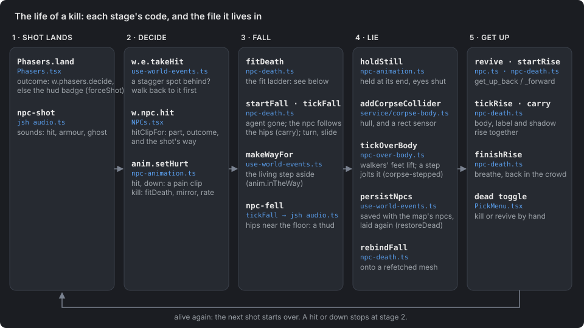
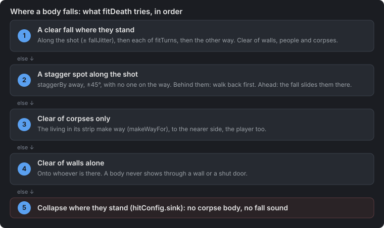

# Deaths

What happens when an npc is killed: how they fall and where, how a corpse lies and is walked over, and how they get
up again. The ONLY doc for it. The shot that kills them is in `docs/engagements.md`.

| file | what |
| --- | --- |
| `ui/world/src/components/npc-death.ts` | fitting a fall (`fitDeath`), staggering (`staggerSpot`), making way (`inTheWay`), falling and lying (`startFall`, `tickFall`, `restoreDead`, `rebindFall`), getting up (`startRise`, `tickRise`, `finishRise`) |
| `ui/world/src/components/npc-animation.ts` | `setHurt`, which starts a death or a get-up, `holdStill`, and the state: `fall`, `rise`, `staggering` |
| `ui/world/src/service/corpse-body.ts` | a corpse's body: its hull and sensor (`addCorpseCollider`, `postCorpseCollider`), `bodyCrosses`, `upRamp` |
| `ui/world/src/components/npc-over-body.ts` | feet over a corpse (`tickOverBody`), its jolt, `removeCorpseCollider` |
| `ui/world/src/components/use-world-events.ts` | `w.e.takeHit` (a stagger, then the hit, then making way), `makeWayFor`, saving the dead (`persistNpcs`) |
| `ui/world/src/const.npc.ts` | `deathConfig`, `corpseConfig`, `stepFlinchConfig` |

## Killed

A `kill` holds them still once its clip ends (`anim.dead`, `holdStill`).

- Stood, they fall dead the way the shot pushes, held on its last frame (`deathConfig.die`, by the shot's way in their
  own frame).
  - Shot from in front, `die_back`: onto their back, arms a little out, the head about 1m behind where they stood.
  - Else `die_forward`: reaching to catch themselves, onto their front, the head about 1m ahead.
- Each death plays mirrored half the time (`mirroredClips`, made at load: see Mirrored clips in `docs/blockbench.md`),
  at a random rate within `deathConfig.dieRate`. The hurt clock runs at that rate too, so the fall's turn and hold keep
  pace.
- Sat, lain or already collapsed, their pose freezes (`deathConfig.dead`, paused at `deadSecs`).
- Eyes shut, no breath, no hand on the wound, no lean.
- A shove does not move them, nor a drag. A shot only jolts them.
- Their label and bubble sit as a lain npc's, eased down as they fall (`labelYShiftForClip`).
- `npc-hurt` carries `dead`. `npc.kill()` kills them at once, as a chest shot from in front would (`w.e.takeHit`).
  An npc's menu (`PickMenu`) has a **dead** toggle: on, it kills them, off, it revives them.

## Falling

- Falling, they leave the crowd (`startFall`: their agent goes, their physics body stays).
- Each tick the npc moves as far as the clip has carried their hips, and their root goes back as far (`tickFall`,
  `carry`). So their shadow and corpse are where their body is.
- Their hips near the floor (`fellHipsY`), it emits `npc-fell`, for its thud (`docs/audio.md`).
- They need `deathConfig.lieWidth` either side. A wall or obstacle nearer slides them that far off it as they fall
  (`roomToLie`, by `npc.roomAhead`, measured whilst they still have an agent).
- The turn and any slide are done by `fitBy` of the clip, before their body reaches out into a wall.
- A corpse's physics body goes where it lies, so a doorway it lies in is not clear and its door stays open.
- A new mesh, e.g. the glTF refetched, moves a corpse's fall onto its hips (`rebindFall`), else it would jump.

## Where a body falls

A fall must fit (`fitDeath`).

- **Clear floor** for `deathConfig.lieLength` along its way (`npc.roomAhead` with `openDoorsFilter`). A door not yet
  slid open is a wall (`w.door.isOpen`), even whilst opening or paused.
- **No one in their room in that strip**, `othersWidth` either side, nor any corpse's hull across it (`stripClear`,
  `bodyCrosses`). That is narrower than `lieWidth`, so bodies may overlap a little.
- **The order tried.** The shot's way first, turned to fall along the shot (`alongShot`) and then by each of
  `fitTurns`. Then the other way, at their own facing. The shot's line is first turned up to `fallJitter` at random,
  mostly a little (cubed), so the dead do not lie aligned.
- **Staggering.** If none fits, stood, they look for a spot that does along the shot, give or take 45°, within
  `staggerBy` (`staggerSpot`), with no one on the way there.
  - Behind them, they walk back to it, then fall (`w.e.takeHit`, which the phaser calls). Further hits are ignored
    meanwhile (`anim.staggering`), and a move that stops them short has them fall where they are.
  - Ahead of them, the fall slides them there instead, hidden by `die_forward`'s stumble (`startFall`'s `slide`).
- **Over the living.** If no spot will do, they fall clear of corpses alone, over the living, who make way. Else clear
  of walls alone, onto whoever is there.
- **Walls all round.** They collapse where they stand (`hitConfig.sink`), held on its last frame. They then have no
  corpse body to step over.
- **Making way.** Whoever living stands where a body will lie steps out of its strip, quickly, to the nearer side
  (`anim.inTheWay`, `w.e.makeWayFor`), far enough that it passes beside them, the player too.
  One who cannot move, e.g. hard pinned or hurt, stays put.

## Walking over a corpse

Others step over a fallen corpse, or onto it (`npc-over-body.ts`, `corpseConfig`).

- **Its body.** Once its die clip is held, a corpse keeps where it lies (`fall.body`, `service/corpse-body.ts`).
  - Its footprint is a convex hull of its parts' boxes, head to shins, arms included.
  - Its height `top` is its torso's, since the big head would have them stand high on it.
  - Its height ramps up over `ramp` from the hull's edge (`upRamp`).
- **Its sensor.** A rect round the hull, `margin` wider, is posted to the physics worker as `corpse-{npcKey}`
  (`postCorpseCollider`).
  - Its `enter-collider` and `exit-collider` carry `meta.corpse`, and fill a walker's `overBody.on`.
  - It goes when they are revived or removed (`removeCorpseCollider`). That fires no exits, so whoever was on it is
    let off directly.
  - A physics rebuild loses it, so `w.npc.syncCorpseColliders` posts each again.
- **Feet.** Whilst `on` holds a corpse, each foot lifts so the middle of its sole clears the body under it by `clear`
  (`footLift`).
  - The knee bends to lift it: the thigh forward, the shin back twice as far, the foot level again. Their hips stay.
  - With both feet on it, their root rises towards the lower foot's lift, at `speed` either way. So they stand on it.
    Running, one foot at most is down, so it rises towards the higher instead, and they rise over it.
  - It runs after the stance, before the flinch, writing over what the pose left and putting it back next tick.
- **A jolt.** A foot planted on a body, as its pose has it, after not, jolts the corpse by its nearest part
  (`flinch` with `stepFlinchConfig`, pushed down). It emits `corpse-stepped`, for a soft tread (`docs/audio.md`).

## Getting up

`npc.revive()`, or `pose npc-0 as:breathe`, is `setHurt(null)`. Fallen, they get up first, by `deathConfig.getUp` of
the clip they fell by, e.g. `get_up_back` (`startRise`). Its first frame is the death's last.

- Their root is held back as it lay (`rise.offset`), and the npc follows their hips as a fall does, the root going
  back by as much (`tickRise`). So their body never jumps, and their label and shadow stay over it. Their label rises
  over the whole clip.
- Stood, the hold goes and the npc moves by what is left (`finishRise`). Then they are back in the crowd, in their
  idle. The get-up's last frame is `breathe`'s first, so it hands on with no fade.
- `get_up_back` sits up, then rolls forward into a squat. `get_up_forward` pushes up onto hands and knees, then kneels
  up over one foot.
- A fall with no get-up in `deathConfig.getUp` is let go at once, as is a death sat or lain.
- A respawn (`spawn`) lets them go at once, dead or hurt, with no get-up or fade (`setHurt`'s `snap`, in `rawSpawn`).

## Spawned dead

`spawn rob at:… dead` spawns them dead (`SpawnOpts.dead`), and `dead:die_back` in a clip of choice. By default they
lie sat or lain as their idle is (`deathConfig.dead`), else fallen either way (`anim.restoreDead()`). A corpse may lie
off the navmesh, so long as it is in a room: it lies exactly where put, out of the crowd. A saved corpse is restored
this way.

- Lain at once, their label is put at its height, not glided down as by a fall.
- Any stance hold is let go first (`docs/npc-stance.md`). Else its sink, from standing, drags the body under the floor.

## Saved

The dead are saved with their map's npcs: `dead` is the clip they lie in, and `at` where their body lies
(`persistNpcs`). Restored, they lie there again, held at its end, out of the crowd, their sensor back (`restoreDead`).
