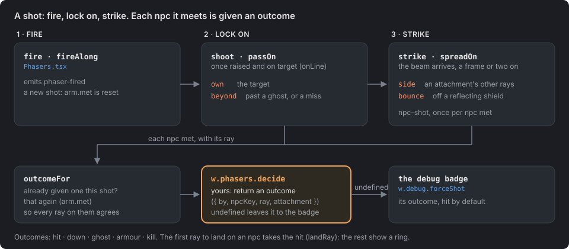
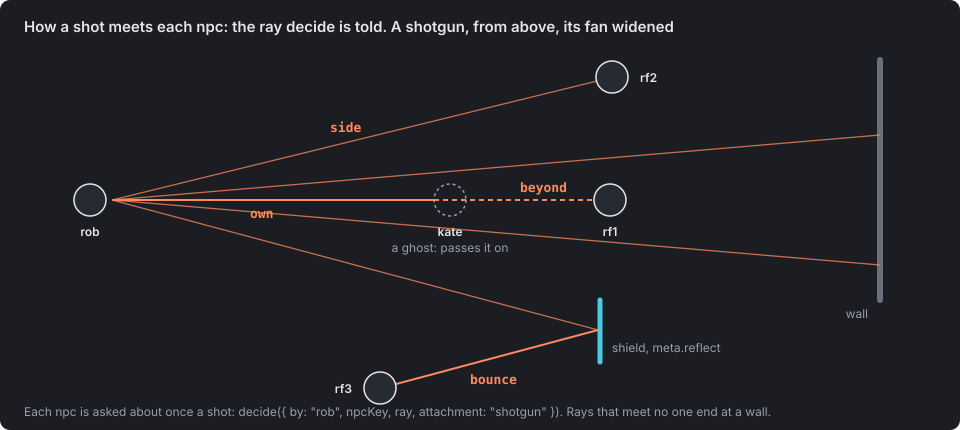

# Engagements

What happens when one npc shoots another: how a shot ends, what a hit does, and how a shooter targets someone.
The ONLY doc for it. Carrying, raising and aiming the phaser are in `docs/inventory.md`.

## In short



1. **Fire.** The player's `m`, jsh `phaser rob --fire`, or `w.phasers.fireAlong`. It emits `phaser-fired` (`by`, `charge`).
2. **Lock on.** Once the raised phaser's muzzle is on target, the beam locks on (`w.phasers.shoot`). Each npc it will meet is given an **outcome** here or as it lands.
3. **Strike.** A frame or two later the beam arrives (`strike`). Each npc met emits `npc-shot` (`by`, `npcKey`, `part`, `outcome`) and the outcome takes effect.

**Outcomes are yours to decide**: set `w.phasers.decide` (see [Deciding outcomes](#deciding-outcomes)). Left unset, the debug badge decides, `hit` by default.

## Outcomes

| outcome | the beam | effect |
| --- | --- | --- |
| `hit` | lands on the part | see [What a hit does](#what-a-hit-does): they recover after |
| `down` | lands on the part | a hit that puts them down, collapsed or pacified |
| `ghost` | passes through them, once they are a stipple | see [Ghost](#ghost) |
| `static` | passes through them, once they are a dot screen | as a ghost: see [Ghost](#ghost) |
| `armour` | lands where aimed, as a hit does | see [Armour](#armour) |
| `kill` | lands on the part | a hit that leaves them dead: see [Kill](#kill) |

## Deciding outcomes

`w.phasers.decide` is a function you set. It is asked for the outcome of each npc a shot meets.

```js
w.phasers.decide = ({ by, npcKey, ray, attachment }) => {
  if (npcKey === "kate") return "kill";
  if (by === "rob" && ray === "side") return "down"; // the other rays of rob's shotgun or caliber
  return undefined; // the debug badge decides
};
w.phasers.decide = null; // stop deciding
```



- **What it gets**: who fired (`by`), who was met (`npcKey`), the attachment fitted (`attachment`, else `null`) and how the shot met them (`ray`):

  | `ray` | met by | asked |
  | --- | --- | --- |
  | `own` | the shot's own line, at its target | as the beam locks on, so a `ghost` passes through |
  | `beyond` | the same line, past a target it passed through or beside (`passOn`) | as the beam locks on |
  | `side` | an attachment's other rays (`spreadOn`) | as they land |
  | `bounce` | a ray off a reflecting shield (`strikeLeg`, `spreadOn`) | as it lands |

- **What it returns**: an outcome, or `undefined` to leave it to the debug badge. A throw is warned and left to the badge.
- **Once per npc per shot.** Each answer is kept for the shot (`outcomeFor`, `arm.met`), so every ray meeting the same npc agrees. Only the first ray to land on them takes the hit (`landRay`). The rest show a ring, and sparks off armour.
- **Kept** in the phasers' state, so a hot reload keeps it. A World remount does not: set it again from jsh on boot (`docs/autorun.md`).

**The debug badge** (`w.debug.forceShot`) decides whatever `decide` leaves.

- It shows on the phaser slot whilst **phaser** is ticked under **debug** in the World menu's **hud** select (`w.debug.hudDebugShown`, persisted per World).
- A click cycles it through `hit`, `down`, `ghost`, `static`, `armour` and `kill`. Unticking it resets it to `hit`.

## How a shot ends

The beam strikes `fadeSecs / lockRate` after it locks on. jsh `sounds` plays `phaser-fired` and `npc-shot`: see `docs/audio.md`.

- **Raised and on target first.** No shot locks on until the muzzle's line passes within `lockRad` of the lock point (`onLine`): only then does `wieldBeam` show the beam and set `beam.next`. The lock is far quicker than the arm, so else a shot would land unseen from a lowered phaser, or off the barrel whilst they still turn. The beam waits too, as the arm follows it: shown early, it would swing round ahead of their turn.
- **Missing them.** A shot whose line, from the muzzle through the dot, meets no part of them has no outcome and sends no `npc-shot`. It passes there, e.g. they moved since it was aimed.
- **Passing them** (a ghost or static, or a miss), it runs on to the wall beyond: one raycast from the target along the shot, found by `wallBeyond` within `passMax` metres. Until that returns it runs `passStub` past them. It meets the floor first if it is heading down.
- **Whom it meets beyond** (`passOn`): those within reach of its target, in turn along its line, short of that wall, by the box test targeting makes (`npcOnRay`).
  - Each is given an outcome (`ray: "beyond"`). One already a ghost passes it on, kept as they are (`passesThrough`, `service/phaser-beam.ts`).
  - The first that is not a ghost stops it, and is landed on (`shot.beyond`).
  - It waits, unseen, until these are found, and every ghost among them is one (`shotWaits`).
- The player hears how a shot of theirs that did not hit ended (`w.hud.say`): `ghost`, `static` or `armour`.
- One lock hits each npc once. Hits are not mirrored over the network.

### Ghost

They become a ghost, and the shot passes through them (`w.npcGhost`, `ghostConfig` in `const.npc`). A `static` shot is the same, but for their look.

- As the shot locks on (`shoot`, `ghost`), their body becomes a stipple over `inSecs`: up to `ghostConfig.stipple` of their screen pixels dropped, evenly. It is the npc's `stipple` uniform, which leaves their label and outline be.
- `static` makes a dot screen instead, its dots fixed on the screen (`dots`, as `dotScreen` in `extra-fx`). It is the npc's `dotScreen` uniform.
- The shot waits, unseen, until they are a ghost (`isGhosting`), then passes through them, as one aimed beside them would (`shot.through`, `shot.past`): on to whom it meets beyond (`passOn`), else the wall. No clip plays, but `npc-shot` is emitted.
- Meanwhile no phaser targets them (`syncTarget`): its dot passes through them to the wall, or whoever is behind.
- They stay so `holdSecs` after it strikes, else `missSecs` after it locked on, then come back over `outSecs`.

### Armour

The shot glances off them (`w.npcArmour`, `armourConfig`).

- A ricochet streak leaves where it landed, mirrored about the face of the part it met, with a spray of sparks off that face. A shot at a part's middle takes the face it enters by.
- They flinch: the struck part, and each bone it hangs from by `falloff` less, turns away from the shot about its joint, easing back over `flinchConfig.secs`. The hips and legs stay, so the feet do.
- Every burst of one moment is kept, e.g. a shotgun's rays (`NpcArmour.flash`).

### A shot at no one

Fired with no one targeted (`w.phasers.fireAlong`), a shot runs straight along the aim. Npcs are ignored by its own line.

- It is a `FreeShot` beam target, a point rather than an npc. The fades are an npc shot's.
- Its end keeps its length along the live aim (`freeEndOf`), as the dot does. So a strafe sweeps it along the wall.
- Once the arm is up, one cast looks along the aim (`castAlong`, over `endsAlong`), from the muzzle's height: stood or crouched `headY - gunBelowHead`, sat or lain the tip's. So a crouched shot meets lower obstacles.
- Tilted (`tilt`), it slopes: `y + d·tan(pitch)` at `d` metres along the ground.
- It ends on the first of these:
  - a wall or closed door
  - the floor (tilted down) or the ceiling (`wallHeight`, tilted up)
  - an obstacle it meets at its height (in at a side, or down through its top or up through its underside)
  - a shield it can't pass (which glows)
  - else `alongMax` metres on, a geomorph's width. Its far end may be off the map.
- Struck, it emits `phaser-struck` (`by`, `at`, `what`: `wall`, `door`, `floor`, `ceiling`, `obstacle`, `decor`, `shield` or `nothing`).
- An attachment's other rays, or a bounce, may still meet npcs: see [Attachments](#attachments).
- Not fired within `fireSecs`, e.g. drawn in throughout, it is given up.

## What a hit does

A `hit`, `down` or `kill` has `w.npc.hit` play a clip on them, once the beam reaches them and no shield or obstacle stops it. It emits `npc-hit`.

**Obstacles.** The beam's cast runs from the muzzle at full aim to the part (`arm.sight`). Each tick it stops where it first meets one: at its side, or down through its top or up through its underside (`acrossStop`). Nothing within `partDepth` of the part's middle stops it, e.g. a thigh on its seat. Stopped, it never lands.

The clip depends on the part locked on to, and on whether they stand, sit or lie (`hitConfig` in `const.npc`):

| part | stood | sat / lain |
| --- | --- | --- |
| head | `pain_head` | `{sit,lie}_pain_head` |
| chest, stomach, hips | `pain_high` | `{sit,lie}_pain_high` |
| an arm or leg | `pain_{arm,leg}_{left,right}` | `{sit,lie}_pain_low` |

Its pain clip plays once. After a `hit` they go back to rest, or to what they were in. After a `down` (`hitConfig.next`):

| part | after |
| --- | --- |
| head | `pacified` (or `{sit,lie}_pacified`) loops |
| body, stood | `collapse` plays instead of `pain_high` (`hitConfig.sink`), then `collapsed` loops: sat on the floor, slumped, breathing hard |
| body sat or lain, or a limb | back to rest: `breathe`, `sit` or `lie` |

- A head shot's clip ends slumped, so goes straight on.
- `collapse` (1.65s) is a stunned sway, then the left knee gives and they sink where they stand. It ends on `collapsed`'s first frame, so goes straight on. Their eyes are `scared` from then until released.
- A hurt clip fades in over `hitConfig.fadeInSecs`, so its first jolt reads.
- Collapsed, the right forearm lies across the lap, so a gun in hand stays clear of others' feet.
- Pacified or collapsed lasts until released: `pose npc-0 as:breathe`, or `as:sit` / `as:lie`.
- Whilst hurt (`anim.hurt`) they can do nothing. A move under way is stopped (it rejects with `hit`), their phaser is lowered, and `move`, `look` and arming are refused.
- A shove (`w.e.move`'s `shove`, e.g. jsh `sidestep`) still moves one pacified, or one collapsed. Collapsed, they scoot back-first in `collapsed_drag` (`anim.dragged`), at `dragConfig.speed`, turning as they go.
- Pain on someone already pacified or collapsed leaves them as they were after.
  - A stood pain clip never plays on one collapsed (`hitDown`), a head shot's included: they stay down, jolted, a hand on the new wound.
  - A head shot on someone pacified has no effect, nor does the label, or no part.

### Where it lands

A hit reacts to its point and its way (`w.npc.hit`'s `impact`, from `strike`).

- **A jolt.** The struck part, and the bones it hangs from, turn away from the shot (`flinch` with `hitFlinchConfig`). Whilst pacified or collapsed they stay turned `hold` of the way. Released, it eases out.
- **A hand on the wound** (`npc-clutch.ts`, `clutchConfig`). The left hand, or the right for a left-arm wound, reaches for where it landed, held in that bone's frame (`clutch.wound`), by `reachTo`.
  - On the head or torso (`coreParts`) it goes on the front, or the front half of the side towards the hand, whichever is nearer the wound, never the back. A side point within `sideMin` of the shoulder takes the front instead, else the arm folds up. So a shot in the back is held at the flank or front, and one behind the head at the temple.
  - The face is chosen once a wound (`clutch.face`), else it could flip mid-reach as they move.
  - On a limb, the palm goes on the side of the bone it reaches without crossing the body, leaning to the front.
  - The palm rests `palm` off the surface, the hand's half-thickness, as the forearm lies along it. On the head, met end-on, `palmHead`.
  - It runs last each tick, after the flinch and the stance, so the hand meets the wound where they leave it.
  - It crosses their middle by `cross` at most. A point across the torso, up to just over its top, goes onto the front of the chest's or stomach's box (`bodyPart`). So a wound on the other arm is clutched on the chest beside it.
  - The elbow heads in front of the chest as far as the hand crosses their middle (`elbowWay`, `reachTo`'s `elbowTo`), so the arm crosses in front of the body. A hand on its own side has the elbow out beside them, unless it is raised, e.g. at the temple, which brings the elbow forwards.
  - Only within reach, e.g. not a shin whilst stood. It stays `lingerSecs` after they recover, or are released, unless they move or the arm takes a pose. It eases in and out over `easeSecs`.
- Their body faces `-z` in its bones' frames, turned by `npc.rotation.y`, so ahead is `(-sin, -cos)`. Their group is not turned.

### Kill

A `kill` leaves them dead. Stood, they fall the way the shot pushes, where a body fits, and others may walk over the corpse. See `docs/deaths.md`.

## Targeting

`NpcFocus` (`w.npcFocus`) holds who targets whom. An npc's phaser shows as a red dot over its target's head, several side by side. The player's, and any with a laser, has its laser dot on them instead: pulsing whilst on whom it meets (`laser-pulse` in `world.css`). Psi shows no mark.

**The phaser.** Whilst the player's phaser is raised it targets (`w.npcFocus.target`, on its `phasers` event). So does one with a laser.

- **The cast.** A cast runs along its aim, returning where a shot at no one would land, and the rooms it passes through.
  - Every aim due one is cast in a single worker request (`syncEnds`, over `w.phasers.endsAlong` and `w.e.raycasts`).
  - One batch runs at a time, and again only once the muzzle has moved `castMovedM` (1mm), the aim turned or tilted `castTurnedRad`, or a door or shield changed (`recast`).
  - So a still aim casts no more, and a frame is asked for only when its end changes: the World may rest.
- **The target** is the nearest npc in those rooms, through doors and windows alike, whose parts the live aim's ray meets (`npcOnRay` in `service/aim-target.ts`), short of where the cast stopped, or within `againstM` past it.
  - One it passes over or beside is not targeted, so whoever is behind them may be.
  - It is found each frame on the main thread (`syncTarget`), so a strafe or `r` sweeps it. A wall between is never crossed.
- **Height.** The aim's ray (`w.phasers.aimRay`) starts at the muzzle, so it follows stand, half crouch and full crouch.
  - jsh `phaser rob tilt:-1` tilts anyone a detent up or down (`tilt`): −8°, level, +8° (`tiltRad`). The arm pitches to suit, easing over `tiltSecs`, and aims fully along it past `pitchFullRad`. Lowering levels it.
  - The player has no key for it: detents were hard to aim with.
- **The dot.** On someone, the red dot pulses, and is where that ray meets their parts (`placeOn`, the entry's `met`), by the same box test a shot makes (`partOnRay`), each frame. It culls first: missing a cylinder `cullRadius` about them in plan, nothing is tested, else only bones within reach of the ray's heights across them.
- With no one met, a small red dot marks where a shot at no one would land (`placeEnd`), drawn along the live aim. The player's alone. None is drawn where nothing stops it (`what: "nothing"`), e.g. out of a hull window.
- **Aiming.** Raised, Space held aims in earnest (`w.phasers.steady`, `isSteadied`): the left hand steadies the gun, and the view extends along its line to the first wall or door (a far look). Raised alone, the view keeps the look's own framing.
- **Firing.** `m` fires whilst raised, aiming or not (`fire`, from `w.player.releaseCharge`), so a click still picks.
  - It is locked on the part the dot is on by `w.phasers.arm`, as every shot is, landing where the dot is. That point is held in the part's bone frame (the target's `local`, read by `targetPoint`), so it moves with them.
  - As it locks on (`shoot`, `meetPart`), the line from the muzzle tip through the dot is tested against each hit region's bone, by the box round what it moves most (`partOnRay` in `phaser-beam.ts`). The nearest met is the part hit, and its point: a forearm in the way takes it.
  - Meeting none, it has no outcome, and runs on through the dot to whom it meets beyond, else the wall. Only a shot aimed from the dot is tested: jsh `shoot:kate part:hips` is not.
  - With no one met, it fires along the line ([A shot at no one](#a-shot-at-no-one)), at the dot's end if it was cast along this aim. The phaser stays raised, and so does the targeting. Space with the phaser lowered is a far look instead: see `docs/camera.md`.
- **Charging.** Raised, `m` held charges the shot (`w.phasers.charge`), full after `chargeSecs`, and let go fires it (`w.player.releaseCharge`). The shot takes the charge (`takeCharge`, in `arm` and `fireAlong`): `fireCharge` widens and brightens its beam, and `phaser-fired` carries it as `charge`. A tap fires at once, near `0`.
  - Charging, the gun brightens with the beam's colour and shakes (`glowOf`, the `phaserCharge` attribute).
  - `e` whilst charging cancels it (`cancelCharge`): it sputters out over `coolSecs`, the phaser left raised, and none charges meanwhile. Focus leaving the World cancels too.
  - On touch, raised, hold a finger anywhere, then put a second down at least `fireTouchDelayMs` later: it charges where they face, without turning them, and letting it go fires. Letting go of the first cancels (`onFireTouch`). The camera ignores both meanwhile, and a long press opens no menu whilst armed.
  - It has no effect on the outcome yet.
- **Anyone may target**, through jsh: `phaser rob --target`, `tilt:1`, `--fire`, `--cancel`. An npc's ends when fired or cancelled, and shows a dot over whom it targets.
- **Decor** stops a shot, as an obstacle does: a quad, bar a switch or a keycard, e.g. a screen or a box on a table (`stopsShots`). Its box is the cuboid drawn. A shot ending on one reports `what: "decor"` and its `decorKey`, in `phaser-struck` too. So a box between hides whoever is behind it from a phaser's target.
- **Aiming at a part.** jsh `phaser kate at:rob part:leftarm` targets, and aims kate at the middle of that part (`w.phasers.aimAt`).
  - Each tick she faces it, and her pitch eases to it in place of a detent (`pitchAt`, kept after).
  - It is let go of once aimed (`aimedRad`, else `aimSecs`), and the command then ends. With `--held` it follows them until killed, a tilt, a cancel or lowering, and firing keeps her targeting. Either pauses with the World.
  - The ray still decides what is met, so a forearm in front takes it. `shoot:` names a part with no ray at all.
- **A laser** gives an npc the player's laser dot (`showsDot`): a target icon in their menu (`PickMenu`, joined to "phaser") or "sight" in their speech menu, disabled without a phaser. Or jsh `phaser kate --laser` (`laser:false` takes it). Theirs then targets whilst raised, and stays after firing, as the player's does (`w.npcFocus.setLaser`, `lasers`). It is not saved.

**Psi** focuses on someone to act on them: see `docs/psi.md`.

## Beam looks

A phaser's look is its beam's style and colour, and its attachment (`PhaserLook`, `service/phaser-look.ts`).

- It comes from its item's meta, saved with the map: `beam`, `beam-color`, `attachment`. A bad value is ignored.
- jsh `phaser` overrides it until the page reloads (`w.phasers.setLook`, `lookOf`):
  - `phaser rob beam:lightning color:#4cf`, `phaser rob attachment:shotgun`
  - `attachment:none` takes the attachment off, and `--reset-look` drops the override.
  - Given only these, it prints the look.
- With the bar's phaser debug shown, the phaser slot's right-click menu does the same for the player: each of beam, color and attachment cycles on a press, the menu kept open (`lookMenu` in `WorldHud`).
- Changing a look recasts.
- Each gun and each beam segment carries its own colour (`gunTint`, `beamColor`). Over a pale deck it is drawn as its hue, fully saturated at `phaserLook.paleLightness` (`beamRgb`).
- A beam is drawn as one or more segments (`beamSegments`), an instance of the beam mesh apiece. Each carries its style, a seed, the charge it was fired with, and whether its end's ball is lit (`beamLook`).
- A segment is a ribbon facing the camera: a solid core with a halo to its edges, its core at least `minCorePx` across (`beamShaderConfig`).
- Styles (`beamStyles`, `beamLook.x`):
  - `plain`: bands drifting towards the target, solid near it.
  - `lightning`: jagged, pinned at both ends, redrawn `jagHz` times a game second.
  - `tesla`: lightning with two thinner forks arcing from the muzzle to either side (`teslaForks`).
  - `static`: straight, its width and brightness flickering along it.
  - `bolts`: dashes racing to the target, for the rotator.

## Attachments

White shapes with black edges, sleeved over the barrel (`attachmentBoxes`, `phaser-gun.ts`).

| attachment | shape | fires |
| --- | --- | --- |
| `caliber` | a box with a hole | 3 parallel rays in a triangle about the axis. They end with the shot |
| `shotgun` | a wide cylinder with a wide hole | 5 rays fanned out 2° apart, ±4° in all. The middle one is the shot. The others go on, each to its own wall (`castSpread`, in `recast`, `arm.spread`), or the floor if pitched down |
| `rotator` | a triangular prism, its end larger, with three holes | `bolts` unless given another style. Held, its fire repeats every `rapidFireSecs` (0.15 game seconds), uncharged (`startAutofire`, `use-world-player.ts`) |

- **Every npc a ray meets is shot**, once a shot each, e.g. a shotgun kills two side by side. Each is given its own outcome (`ray: "side"`, see [Deciding outcomes](#deciding-outcomes)).
  - Any ray meeting someone ends on them, its own ring there, glancing off armour too (`spreadOn`, `attachmentRay`, `arm.spreadHit`).
  - The red dot stays on the shot's own line.
- **The gun** is built from every box's faces (`gunFaces`, `gunGeometry`), the unfitted attachments and what an attachment covers (`under`) collapsing to nothing.
  - A box may be `round`: a prism of `sides` sides, or a cylinder (`smooth`).
  - Its emitters are holes: dark discs proud of its front, glowing whilst armed. The beam leaves their middle (`muzzleOf`).
  - Each face is edged along its own edges, not its triangles' (`gunBary`).
- **The hud's phaser icon** shows the attachment fitted, 1.3 times its size (`phaserIcons`, `service/phaser-icon.ts`, from the same faces). A cylinder's sides are edged only on its silhouette.
- **A phaser lying about** shows its item meta's attachment: `Decor` draws `phaser-{attachment}` (`media/src/decor/phaser-*.svg`) where the decor sheet has it. Re-run `gen-decor-sheets` after editing them.

### Reflecting shields

A shield with `meta.reflect` bounces a shot off it once (`bounce`, `castLegs`).

- A shot at no one stopped by one casts on from just off the shield, drawn as a segment after the ray it left (`beamSegments`' legs).
- The first npc it meets is shot (`ray: "bounce"`), unless another ray already hit them, with a ring there (`strikeLeg`). It may meet its shooter.
- A shotgun's rays each stop at a shield too, and off a reflecting one each bounces alike (`castSpread`, `arm.spread`, a `{ dist, leg }` per ray). An npc met by both a ray and a bounce takes the ray's.
- A caliber's rays bounce with the shot's own line, keeping their offsets.

## Impacts

Where a shot lands, a ring widens and fades in its beam's colour, a flash at its centre at first (`impactNodes`, `impactShaderConfig`).

- They land on someone hit (not a ghost), on a wall or door in the way, and at a free shot's end (`phaser-struck`).
- A ring lies across the shot's way, turned mostly to the camera (`faceCamera`), so it is never seen edge on. One on someone is larger, and a charge widens it.
- `w.phasers.landed` holds them by game time, pruned in `onTick` and sent only as one lands or fades (`writeImpacts`). They age on game time, so a pause holds them.
- Each takes the room slot of whom it landed on, else the shooter's, and fades with it.

## Rays debug

The debug **overlay** select's **rays** draws each raycast for 2 game seconds (`w.e.showRays`, `raysDebug` in `use-world-events.ts`).

- A ray runs from its start, through a disc at each door, window, obstacle or decor edge it crossed, to where it stopped. It is red if a wall stopped it, orange a door, green nothing.
- Each caller passes a `key` (e.g. `rob/sight`, `rob/reach0`, `along`), and its rays replace its last. A cast asks the worker for `debug` (`JshCli.RaycastDebug`) only whilst it is on.
- jsh `rays band rob count:3 width:0.3` or `rays fan rob count:5 spread:20` casts from their aim, else their facing, drawn even with the overlay off.

## Files

| file | what |
| --- | --- |
| `ui/world/src/components/Phasers.tsx` | a shot: `shoot` locks on, `strike` lands it. `decide` and `outcomeFor` give outcomes, `landRay` lands each ray, `shieldStop` stops one at a shield |
| `ui/world/src/service/phaser-arm.ts` | the arm's pure geometry: the gun's line and tip, the hold, its reach to walls and obstacles, the bearing and lock point (`ArmEntry`) |
| `ui/world/src/service/phaser-beam.ts` | where a part is (`bodyPartPoint`), where the beam ends, and a bounce (`reflect`, `Leg`, `legMeets`) |
| `ui/world/src/service/phaser-look.ts` | the look, and the segments drawn from it (`beamSegments`, one `SpreadRay` per attachment ray) |
| `ui/world/src/service/phaser-gun.ts` | the gun's boxes, its muzzle and colours (`gunColors`). After an edit, redraw `media/src/decor/phaser*.svg` to match |
| `ui/world/src/service/phaser-icon.ts` | the hud's icons, projected from the gun's boxes as it loads. `gen-phaser-icon --png` draws them to a file |
| `ui/world/src/service/phaser-gun.shader.ts` | the gun, one instance per gun shown |
| `ui/world/src/service/phaser-beam.shader.ts` | the beam and its ball, one instance per beam segment shown |
| `ui/world/src/service/phaser-impact.shader.ts` | rings where shots land, one instance per impact still fading |
| `ui/world/src/service/phaser.shader.ts` | what the gun and beam share: the beam's colour, `seenBy` |
| `ui/world/src/components/NPCs.tsx` | `w.npc.hit` |
| `ui/world/src/components/npc-animation.ts` | hurt clips (`setHurt`, `hitDown`). The dead are in `docs/deaths.md` |
| `ui/world/src/components/npc-flinch.ts` | a jolt from a shot, and a hit's held lean (`flinch`, `tickFlinch`) |
| `ui/world/src/components/npc-clutch.ts` | a hand on the wound (`takeClutch`, `tickClutch`) |
| `ui/world/src/components/NpcGhost.tsx` | ghost: a dot screen, `w.npcGhost` |
| `ui/world/src/components/NpcArmour.tsx`, `service/armour.ts` | armour: ricochet and sparks, `w.npcArmour` |
| `ui/world/src/components/NpcFocus.tsx` | who targets whom, `w.npcFocus` |
| `ui/world/src/service/aim-target.ts` | whom a ray meets, and where (`npcOnRay`) |
| `ui/world/src/const.npc.ts` | `hitConfig` (hit clips), `ghostConfig`, `armourConfig`, `flinchConfig`, `hitFlinchConfig`, `clutchConfig` |
