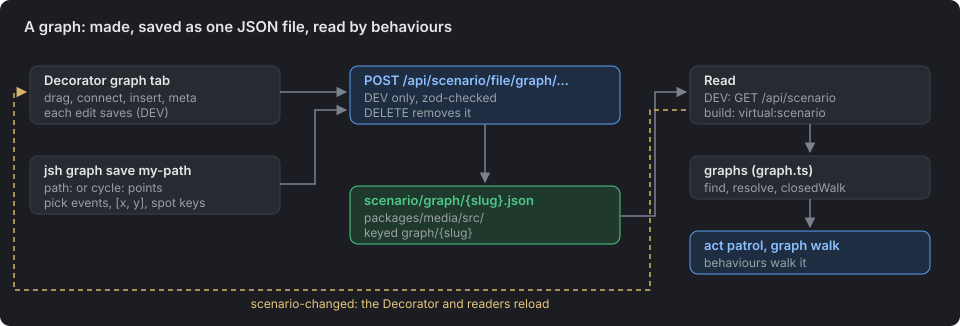
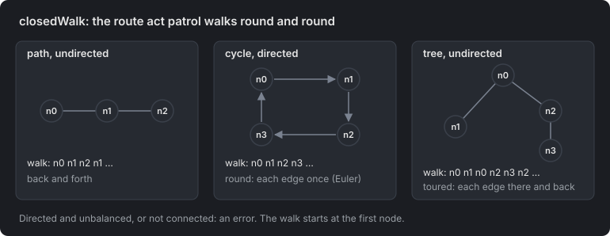
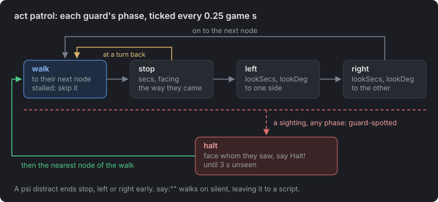

# Graphs

A graph is a directed multigraph on one map, with free-form `meta` on the graph, each node and each edge. Edges run `from` to `to`, and two may join the same nodes either way. An `undirected` graph is read as its symmetric closure: each edge may also be taken backwards. It knows nothing of behaviour. jsh commands read graphs and act on them, e.g. `act patrol`. Graphs are made and edited in the Decorator, or by jsh `graph`.



## The data

One JSON file each, `packages/media/src/scenario/graph/{slug}.json`, keyed `graph/{slug}` and served as in Entry files below. Its schema is `GraphEntrySchema` (`ui/world/src/scenario.schema.ts`).

| Field | Default | |
| --- | --- | --- |
| `mapKey` | | The map its nodes are on |
| `undirected` | `false` | Each edge may also be taken backwards. A new graph has it, from the Decorator or `graph save` |
| `meta` | `{}` | The graph's own |
| `nodes` | | At least one: `{ id, at, spot?, meta }` |
| `edges` | `[]` | `{ id, from, to, meta }`, by node id |

- **A node's id** is stable, e.g. `n3`, so edges survive edits. A new node takes the next free number. So does an edge's, e.g. `e2`, which tells parallel edges apart.
- **A node's point** is `at`, `[x, y]` in metres, on the navmesh to the cm.
- **A node on a spot** has `spot`, its alias or key, e.g. `g0r12-3`. Readers take the spot's point over `at`, so it follows the spot as spots are remade. A spot gone, they fall back to `at`. `at` is its point when last saved.
- **Edges** must join two different nodes that exist. Any number may join the same pair, either way, each with its own meta.
- **Meta** is any JSON object. Behaviours read the keys they know, e.g. `secs` on a node for `act patrol`. Nothing checks them.

## jsh `graph`

`packages/cli/src/jsh/world/graph.ts`, beside `graphs`. Saving and removing need the dev server.

| | |
| --- | --- |
| `graph ls` | This map's graphs, a line each. `--all` for every map's |
| `graph get my-path` | The entry, as a value |
| `graph save my-path path:$( pick 3 ) [directed] [name:…]` | Nodes `n0`… through the points, joined in turn by edges `e0`…. `cycle:<points>` joins the last to the first too. Undirected unless `directed`, else as saved. Points are pick events, `[x, y]` or spot keys, which the nodes keep as `spot` |
| `graph walk my-path` | Its closed walk, e.g. `n0 n1 n2 n1` |
| `graph rm my-path` | |

Saved over, a graph keeps what is not given. Its nodes and edges are replaced only when points are given, and its meta is always kept.

## In the Decorator

The sidebar's **graph** tab (`GraphSidebar.tsx`) lists this map's graphs: name, node and edge counts, and ⇢ unless undirected. Other maps' graphs are listed below by mapKey, and a press on one shows it read-only, drawn, in a dialog inside the panel (`GraphDialog.tsx`). In DEV its **copy to this map** makes it a new graph here (`copyGraph`): the next free `graph/{slug}`, its centroid at the centre of the view, each node snapped onto the navmesh and off any spot. A node off the navmesh is named, to be dragged on. The copy is undoable, as a new graph is. Choosing one draws it on the map (`GraphLayer.tsx`) and centres the map on it. Its nodes and edges are listed too, and a press on one selects it. A node on a spot is ringed, and drawn at the spot. Every edge has an arrow, faint when undirected. Edges joining the same pair bow apart (`edgeBows`, `arc` in `graph-edit.ts`). The spots are fetched whilst a graph is chosen.

In DEV each edit saves its file (`saveScenarioEntry`). The pure edits are in `graph-edit.ts`.

- **New graph** makes `graph/graph-N`: two nodes joined, at the centre of the map shown.
- **Drag a node** to move it, off its spot. Shift or ctrl/alt snap it, as for decor. On release it is snapped onto the navmesh. Off it, the node springs back.
- **Drag an edge** to move the whole graph, every node off its spot. If any node would be off the navmesh, it all springs back.
- **Click** a node or an edge to select it. The sidebar then edits its meta, else the graph's meta and name. The meta is JSON, saved on blur or ctrl+enter, and red whilst it is not an object.
- **Right-click** (`DecorMenu`):

  | On | Items |
  | --- | --- |
  | Empty map | add node here |
  | A node | connect to…, attach to the nearest spot within 0.5 m (or detach from it), delete node and its edges (one is kept) |
  | An edge | insert node here, reverse, delete edge |
  | Either | undirected. Only how it is read: no edge changes |

- **Connect to…** draws a dashed line from the node to the pointer. A click on another node joins them. Escape or a click elsewhere cancels.
- The trash beside the graph's key deletes it, on a second click.

Until the reload has the save, the edited graph is drawn from a draft, so the old one never flashes back. Graph edits share the decor's undo and redo (cmd-Z, shift-cmd-Z), in one timeline: each keeps the graph as it was, or that it did not exist. An undo saves it back, or removes it, and shows it. Making and deleting a graph undo too.

## Behaviours

A behaviour is jsh code reading a graph. `graphs` in `packages/cli/src/jsh/world/graph.ts` is what they share:

| | |
| --- | --- |
| `graphs.find(ct, nameOrValue)` | A saved graph by `{slug}` or `graph/{slug}`, else a graph value, on this map |
| `graphs.resolve(ct, graph)` | Each node's point by id: its spot's, else `at`, saying so if its spot is gone |
| `graphs.closedWalk(graph)` | Node ids walked round and round, crossing every edge |
| `graphs.toNodes(ct, points)`, `graphs.edgesThrough(nodes, cycle)` | Nodes and edges from points, as `graph save` makes them |

Route strategies are written in jsh, beside the behaviour that uses them. As yet there is one, `closedWalk`:

- **Every node balanced** (an even number of edges if undirected, else as many in as out, parallel edges each counted): an Euler circuit, crossing each edge once. A cycle is walked round.
- **Else, undirected:** a depth-first walk crossing each edge there and back. A path is walked back and forth, and a tree is toured.
- **Else, not undirected:** an error, as is a graph not connected. It starts at the first node.



### Patrolling: `act patrol`

```sh
act patrol test-patrol npc:guard-0 watch:rob
act patrol test-patrol npcs:$( [] guard-{0..1} ) watch:$( [] rob kate ) say:Stop!
act patrol cycle:$( pick 4 ) npcs:$( [] guard-{0..2} ) say:""
```

`act patrol <graph> [npc:<key>] [npcs:<keys>] [watch:<keys>] [say:…] [secs:2] [lookSecs:2] [lookDeg:60]` (`act.ts`). Its guards walk the graph's closed walk, else an unsaved `path:` or `cycle:` of points. Who walks it, whom they watch and what they say are given here only, never in the graph.

- **Guards** are `npc:` or `npcs:`, an array or `a,b`, else `guard-0`. Those absent are spawned at their start in an `mtf` skin. Several start as far apart in a straight line as the walk allows: its farthest pair of points first, then each point farthest from those chosen (`startsOf`). On a path they pass each other.
- **Watch** is `watch:`, an array or `a,b`, else the player.
- **At each node** they stop `secs`, then look `lookDeg` either side for `lookSecs` each. Where the walk turns straight back, e.g. a path's end, they stop without looking. A node's meta `secs`, `lookSecs` or `lookDeg` overrides the command's there.

One loop (`walkPatrol`) ticks every 0.25 game seconds for all of them, so a kill or a pause holds them together. Each guard is in a phase:

| Phase | |
| --- | --- |
| `walk` | To their next node. A stall is given up: they skip that node, saying so |
| `stop` | `secs` facing the way they came. At a turn back, nothing more |
| `left`, `right` | `lookSecs` each, `lookDeg` either side of that way |
| `halt` | Facing whom they saw, until 3 s unseen. Then they walk to the nearest node of the walk and go on |



A psi distract ends a guard's `stop`, `left` or `right` early.

Each tick they look for whom they watch with `perceive`, as `sees` does. A sighting emits `guard-spotted` (`npcKey`, `seen`, `graph`), again only after 3 s unseen. Then they halt and say `say` (default `Halt!`) for 3 s. With `say:""` they walk on silent, leaving the sighting to a script: `events 'e => e.key === "guard-spotted"' | …`.

#### Future work

- **Follow edits.** A running `act patrol` reads its graph once. It could re-read it on `scenario-changed`, and re-aim each guard.
- **Other walks.** e.g. the longest simple cycle or path, or the least recently visited neighbour, chosen by `route:`.
- **A halt that ends.** A guard halts until 3 s after losing sight, so someone always in view holds them for good. Give it a limit, or step closer.
- **Spacing kept.** Several guards drift together after a halt or a stall. They could slow or wait to keep their spacing.
- **An in-World overlay** of graphs, as the spots overlay.

## Entry files

Authored in DEV and shipped as data. One JSON file per entry, `packages/media/src/scenario/{kind}/{slug}.json`, its key `{kind}/{slug}`. `ScenarioEntrySchema` (`ui/world/src/scenario.schema.ts`) is a union by `kind`, as yet only `graph`.

`scripts/src/vite-plugin-scenario.ts` provides them:

| | DEV | production |
|---|---|---|
| read | `GET /api/scenario`, every entry by key | `virtual:scenario`, bundled |
| write | `POST` / `DELETE /api/scenario/file/{kind}/{slug}`, zod-checked | read-only |
| change | the watcher sends `scenario-changed`, and readers reload | |

A key must be a known kind and a `[a-z0-9-]` slug, which is what keeps a write inside the folder. The DEV endpoints load the schema with `ssrLoadModule`, kinds included, so a schema edit needs no restart. An edit to the plugin itself does.

The schema and the loader live in `ui/world` (`scenario.schema.ts`, `service/scenario-shared.ts`), so the Decorator and jsh use them without depending on a panel.
