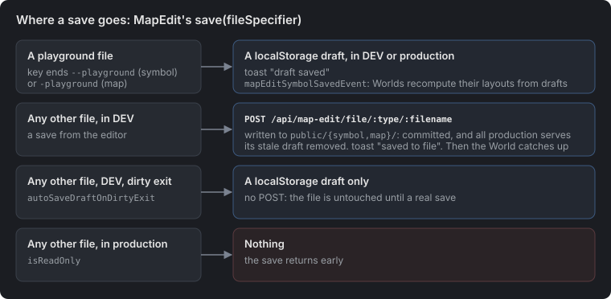
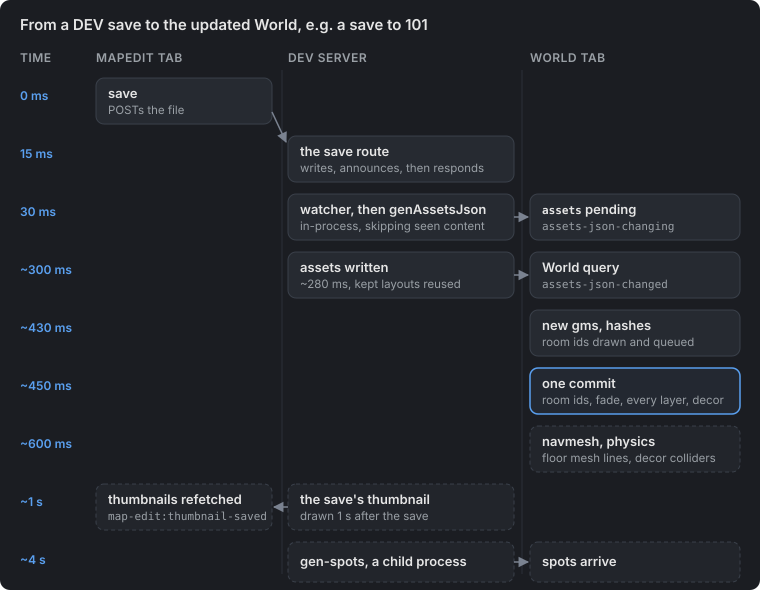
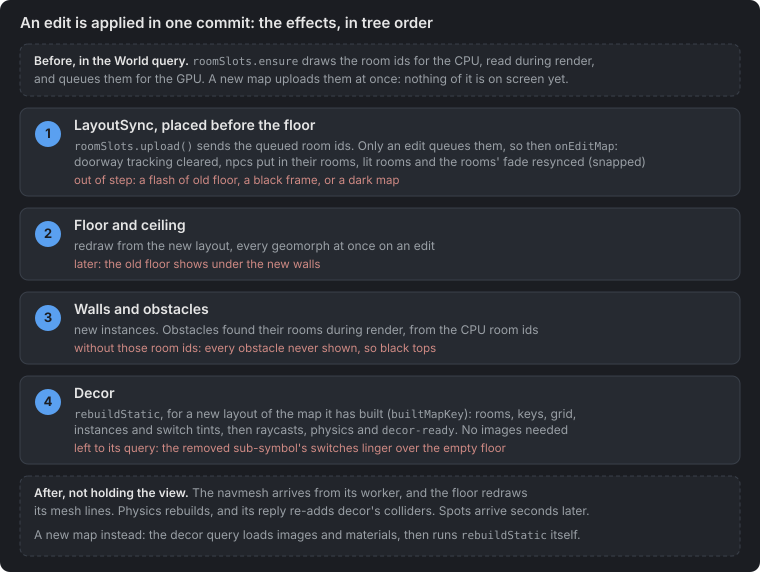

# MapEdit saving

Everything about where a MapEdit file goes when you save it, and how a World catches up with it.
Nothing about it lives in another doc.

| file | what it holds |
|---|---|
| `ui/map-edit/src/MapEdit.tsx` | `save`, `load`, `discardDraft`, `deleteFile`, `updateSavedFileSpecifiers`, the mutations |
| `ui/map-edit/src/map-node-api.ts` | `LOCAL_STORAGE_PREFIX`, `getFileSpecifierLocalStorageKey`, `devMessageFromServer` |
| `ui/map-edit/src/editor.schema.ts` | `MapEditSavedFileSchema`, `isPlaygroundSymbolKey`, `isPlaygroundMapKey` |
| `scripts/src/vite-plugin-map-edit-api.ts` | the save route: writes, announces the file, defers its thumbnail |
| `scripts/src/service/process-map-edit-save.ts` | `writeMapEditFile`, `updateManifests`, `createSavedFileThumbnail` |
| `scripts/src/vite-plugin-watch-assets.ts` | the asset watcher: runs `genAssetsJson`, tells the pages |
| `scripts/src/service/gen-assets-json.ts` | `genAssetsJson` and its layout cache. The CLI `pnpm gen-assets-json` wraps it |
| `ui/world/src/components/World.tsx` | the World query, and `LayoutSync` |
| `ui/world/src/service/room-slots.ts` | `ensure` and `upload`: each room's id, for the CPU and the GPU |
| `ui/world/src/components/Decor.tsx` | the decor query, and `rebuildStatic` |

## Two stores

A file lives in one of two places, never both for long:

- **the filesystem**, `packages/app/public/{symbol,map}/<filename>.json`, committed, and all production serves;
- **a localStorage draft**, under `map-edit:<type>:<filename>` (`getFileSpecifierLocalStorageKey`), per browser.

`load` prefers the draft and falls back to the file, unless called with `ignoreDraft`. What it reads
goes through `migrateMapEditSavedFile`, then `MapEditSavedFileSchema`. So a draft of an older shape is
migrated, or discarded with a warning, rather than crashing the editor.

## Who may save

Two gates, both in `MapEdit.tsx`:

- `isLocked()`: a touch device, or `devForceReadOnly` in DEV. Nothing saves or deletes.
- `isReadOnly(file)`: `isLocked()`, or production on a file that is not a playground file.

So in production only playground files are editable, and their edits only ever reach localStorage.

## Where a save goes

`save(fileSpecifier)` builds a `MapEditSavedFile`: the specifier, `width`/`height`, `nodes`, and
`bounds`, from the underlay image node if there is one, else every node and the svg rect.

- **The draft badge** (`DraftBadge`, `FileMenu.tsx`) reads the localStorage key itself, so it shows
  exactly when a draft stands in for the file.
- **A DEV save removes the file's draft**, since the filesystem is canonical: a draft left behind
  would shadow the file just written.
- **Both mutations**, save and delete, invalidate `["map-edit-manifests"]` on success. They run with
  `networkMode: "always"` in DEV (`QueryClientApi`), else an offline browser pauses the write.

## After a DEV save

### The save route

`vite-plugin-map-edit-api`, through `process-map-edit-save.ts`:

1. `writeMapEditFile` parses and validates the body (`parseRawMapEditFile`), then writes it. A bad
   body never reaches the disk.
2. The file is announced to the watcher at once, without waiting for its file event.
3. `updateManifests` updates the symbol and map manifests for the changed file, then the route
   responds, so MapEdit's refetch sees new files.
4. 1s later (`thumbnailDelayMs`), once the World has updated, `createSavedFileThumbnail` renders
   `<filename>.thumbnail.png` with skia-canvas. A map's is each geomorph's walls in white, read from
   its `layout/{gmKey}.json`, fitted within 1200px. Then `devMessageFromServer.thumbnailSaved` has
   MapEdit refetch its thumbnails.

`DELETE` on the same route removes the file. `deleteFile` (DEV only) removes its draft first, and
loads another file if the deleted one was current.

### The asset watcher

`vite-plugin-watch-assets` hears a symbol or map file change, from the save's announcement or the file
event, and runs `genAssetsJson`.

- **It skips content already processed**: `seen` for a run that succeeded, `sending` for one under
  way. So a save's later file event does nothing, while a failed run can be retried.
- **`genAssetsJson` runs in the dev server's own process** (`ssrLoadModule`), with no process to start.
  It reloads by itself whenever its code, or anything it imports, changes.
- **Two messages reach every page**: `assets-json-changing` as a run starts, `assets-json-changed`
  once it has written. Its own write of `assets.json` is no hand edit (`wroteAssetsJson`), so isn't
  announced again.
- **The WorldMenu's assets button** runs it with `fresh`, then tells every page.
- **`gen-spots`** remakes a changed hull's spots afterwards, in a child process (`docs/spots.md`).

A Vite plugin is loaded once, so an edit to `scripts/src/vite-plugin-*.ts` needs a `pnpm dev` restart.
A service a plugin loads by `ssrLoadModule` reloads by itself.

### The layout cache

`genAssetsJson` keeps each hull's layout, and its file text, in module state (`layoutCache`).

- **A hull keeps its layout** while a hash of what `createLayout` reads is unchanged
  (`layoutInputHash`): its flat symbol, its own symbol, and the obstacles of each symbol in it.
- **It starts empty** whenever the module loads: a dev server start, a reload of its code, or the
  CLI's one run. `fresh` empties it.
- **Layouts keep 5 decimal places** (`roundNumbers`), so float noise never reaches a diff. Every file
  goes through `writeIfChanged`.

## How the World takes in an edit

`assets-json-changing` marks `assets` pending. `assets-json-changed` invalidates the World query, which
fetches `assets.json` and the map's layouts, then makes `w.gms`, `w.gmsData`, `w.hash` and `w.gmsHash`.

An edit of the map on show changes everything drawn in one React commit, so no frame shows it half
done. A new map, or the first load, is hidden behind its fade through black instead.

### Why it is ordered so

Each rule below came from a glitch seen when it was broken.

- **Room ids change on the GPU with the layers.** The floor and ceiling read each room's visibility
  through them (`decodeUvVisibility`). Uploaded early, a frame shows new rooms over old textures.
- **`onEditMap` follows the upload.** It snaps the rooms' fade (`fadeRoomsFx.snapNext`), assuming the
  GPU has the new room ids. Run before it, a frame shows the player's room hidden: all black but npcs.
- **The CPU's room ids are ready before render.** Obstacles find their rooms while rendering
  (`buildInstanceIds`, through `roomAt`). Without them, every obstacle is drawn as never shown.
- **Decor does not wait for its query.** The query awaits images, so lands a frame or more late. It
  waits for `assets`, not the navmesh, which it never reads. Its `staleTime` is `Infinity`, else being
  enabled again after each edit refetches it.
- **Doorway tracking is cleared.** It holds the room each side of a doorway. After an edit renumbers
  rooms, it would move a player in a doorway back into an old room id every tick: a dark map.

### The decor query

`decor-setup` loads the sheet images, draws them into `texDecor`, calls `rebuildStatic`, and builds
the materials. Its key is the World, the map, `texDecor`, a hot-reload count, and the view's light and
fade, so it runs for a new map, new sheets or a hot reload, never for an edit. A new map marks decor not
ready until it has run (`w.decor.ready`). An edit keeps it ready.

### Checking it

A flash lasts a frame, so catch it by recording the World's canvas in the page:

- `canvas.captureStream()`, read by a `MediaStreamTrackProcessor`;
- each frame scaled down by `createImageBitmap`, and scored by its mean brightness;
- a transient frame differs from those both before and after the edit.

Unpause the World first: paused, it renders only on demand. To see a frame, draw it into a canvas
over the page and take a screenshot.

## The file selector

`savedFileSpecifiers` is the source of truth for `MapFileSelect` (`FileMenu.tsx`), rebuilt by
`updateSavedFileSpecifiers(drafts)` from the two manifests and the localStorage drafts.

- **Always make a new array.** Mutated in place, the same reference stops `useMemo` recomputing `mapFiles`.
- **Only maps have a trash button.** Symbols cannot be deleted from the UI.

## Getting back to the committed file

`discardDraft(file)` removes the draft, rebuilds `savedFileSpecifiers`, and reloads with
`ignoreDraft: true`. In production it is the only way back: your edits never touched the file.

It reloads with `preserveHistory`, so ctrl+z brings the discarded nodes back. `isDirty` is cleared
straight after, on purpose: a dirty playground file autosaves its draft on a tab switch, which would
resurrect what was discarded. So an undone discard lives in the editor until you save it.

## Playground files

A file is a playground file when its key ends `--playground` (symbol) or `-playground` (map): that
suffix is the whole test (`isPlaygroundSymbolKey`, `isPlaygroundMapKey`). It makes a file editable in
production, and `DerivedGmsData` skips playground symbols when keying geomorph data by number.

**`g-301--playground` was drawn by hand.** The core geomorphs' hulls and doors come from the starship
symbol pipeline; this one was drawn in MapEdit and committed as `public/symbol/g-301--playground.json`:

- an `image` node for the underlay, `g-301--playground.png`, from `media/src/starship-symbol/playground/`;
- a `hull` group: paths named `wall hull`, one `window hull y=1.1 h=0.6 curved`, one `wall hull sans-n--20x10`;
- a `doors` group: rects named `door hull edge=s|w|e slide=[…]`, each paired with a `decor quad key=switch` image.

The node **names are the tags**: `wall hull` makes a path a hull wall, `door hull edge=s` makes a rect
a hull door. It is registered in `symbolByGroup.playground` (`media/src/starship-symbol/const.ts`),
which assumes every playground symbol is a hull symbol.

## Renaming a map (DEV)

The World menu's map picker has a pencil on each map that may be renamed, bar the current one. It
prompts for the new key, and an alert gives any refusal. `w.renameMap(from, to)`:

1. refuses a bad key, or one in use (`mapRenameError`, `service/map-rename.ts`). `defaultMapKey`,
   `emptyMapKey` and playground maps keep their keys (`isRenamableMap`);
2. refuses a map any World is on, this one included, since its live state would be saved under the old key;
3. saves the file as `to` through the map-edit API;
4. moves the saved state: every World's `world:{worldKey}:map:{from}` (`renameWorldMapStores`), and
   jsh's `/shared/map/{from}`, through a `map-renamed` event that `pred.ts` handles;
5. points the graphs on `from` at `to`, then deletes the old file, its thumbnail and index entries.

It doesn't carry saved state in other browsers, nor MapEdit's open copy of the file, which needs reloading.
