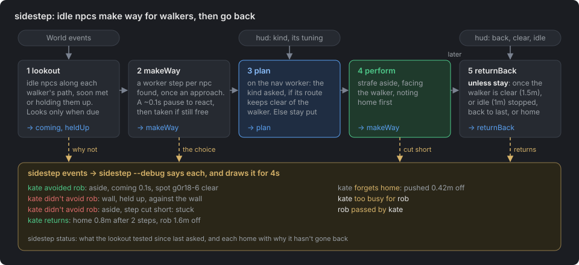
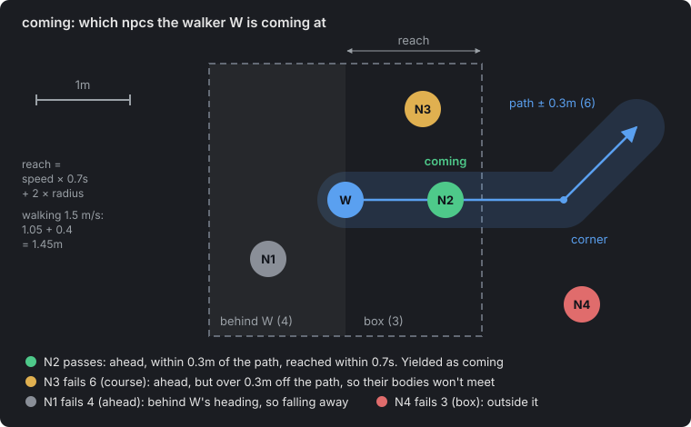
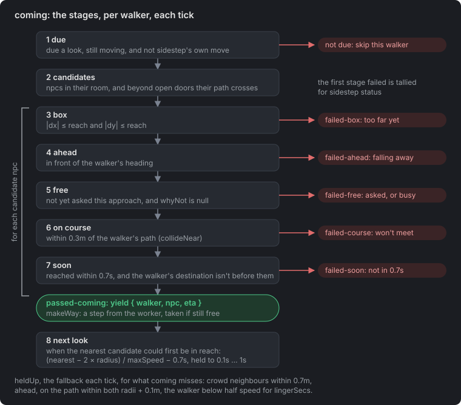
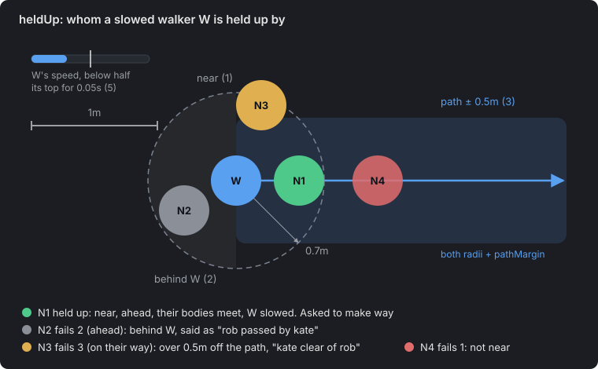
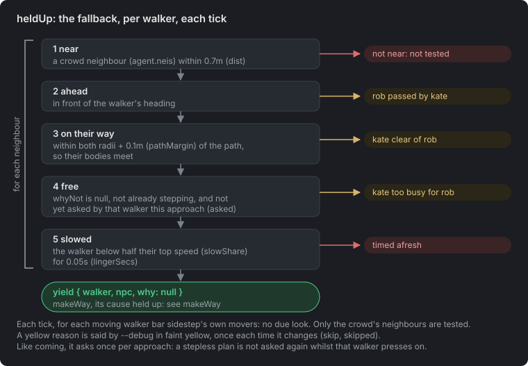
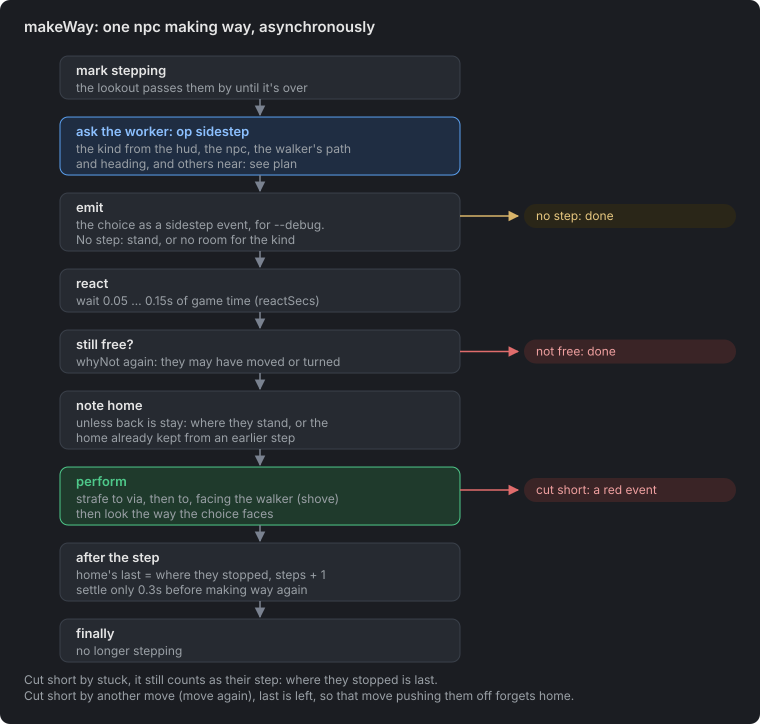
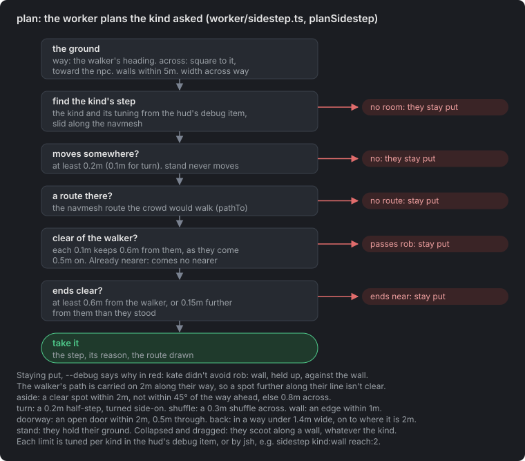
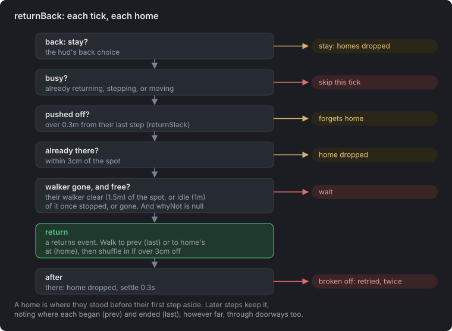

# Sidestep

jsh `sidestep` (`packages/cli/src/jsh/world/sidestep.ts`, in the default PROFILE) has idle npcs make way for a walker coming at them or held up by them. It is a keyed tick, not a process. `sidestep off` removes it.



Its parts, each a section below:
1. **lookout**: the idle npcs along each walker's path, soon met or holding them up (`SidestepLookout`). A walker looks only when due, not every tick, and only at their rooms' npcs and crowd neighbours.
2. **makeWay**: for each npc found, once per approach (at most every `askedSecs`), asks the nav worker for a step of the kind asked. It takes the step after `reactSecs` (0.05 to 0.15s), if they are still free.
3. **plan**: the worker works out the kind asked for, and tests its step.
4. **perform**: the step, noting home first.
5. **returnBack**: later, unless `stay`, back to their last spot or home.

The diagrams are in `docs/sidestep/`. `diagrams.py` there regenerates heldUp's stages, makeWay's, plan's and returnBack's, writing to the folder it is run from.

## lookout

`SidestepLookout` (`sidestep-lookout.ts`) decides who is in whose way, from its two methods' numbered stages. It is jsh's alone: `sidestep status` is the way in.

**Walkers.** Only moving npcs look. The lookout keeps them from `started-moving`, `stopped-moving` and `removed-npcs`. Each holds cached candidates: their room, and its doors with the room beyond each. Those are placed when they start and on `enter-room`, never per look. Npcs in a room come from the live `w.npc.roomToNpcs`, and a door's `open` from `w.door.byKey`. Sidestep's own movers, stepping aside or going back, are passed over (`ownMove`): they make way, never ask for it, so one npc's step cannot set others off. Tick `chain` in the debug item, or `sidestep chain:true`, to let them look too, e.g. to watch how a crowd behaves.

**Coming** (`coming`) runs over every walker each tick. Seen from above, with rob (`W`) walking right:



Each npc goes through the stages in turn, and their outcome is tallied for `sidestep status` (`ComingOutcome`): the test they failed, e.g. `failed-box`, else `passed-coming`.



1. **due:** their next look has come. A walker with no one near looks once a second, not every tick.
2. **candidates:** those in their room, and beyond any open door of it within `reach` whose line their way crosses. So nobody is tested through a wall, and nobody else on the map is tested at all. `reach` is how far they go in `anticipateSecs`, plus both radii: 1.45m walking.
3. **box:** `|dx|` and `|dz|` within `reach`, a cheap square test before any distance or path work.
4. **ahead** of them. Someone behind the walker never needs to move.
5. **free**, and not yet made way for them this approach (`asked`, forgotten once that walker stops, goes or passes them, or after `askedSecs`).
6. **on course:** their path, not just their heading, within `collideNear` (0.3m) of them. So a walker turning a corner is judged by where they will go.
7. **soon:** reached within `anticipateSecs` (0.7s), the gap between their bodies over the walker's speed, and before the walker arrives where they are going.
8. **next look:** no sooner than they could reach the nearest candidate, measured as in the box, between `lookSecs` (0.1s) and `lookMaxSecs` (1s). Anyone stopping or going has every walker look at once.

**Held up** (`heldUp`), the fallback each tick, for what `coming` misses, e.g. setting off beside someone. Seen from above, with rob (`W`) slowed:





1. near: a crowd neighbour within `dist` (0.7m, the crowd's `collisionQueryRange`).
2. ahead.
3. on their way: within both agents' radii plus `pathMargin` (0.1m), so their bodies meet.
4. free, and not yet asked by that walker this approach (`asked`, as `coming`).
5. slowed: below `slowShare` of their top speed for `lingerSecs`.

Like `coming`, it asks each npc once per approach. They are asked again once that walker stops, goes or passes them, or `askedSecs` (1s) on if still in the way. So a jammed walker, pushing on with almost no speed, has them make way again, and a `chain` can start. Until then `--debug` says `kate already tried for rob`.

**Free** (`whyNot`) means on the navmesh, idle and stood (or stood pacified, or collapsed and dragged), `stillSecs` past stopping or collapsing (only `ownSettleSecs` past sidestep's own step aside or return), and not already stepping. It tells `moving` apart from `busy` (mid-look or fading). On their own way back, neither moving nor settling holds them (see returnBack). The player too, but only `playerStillSecs` (3s) past their own last walk, so their walking always wins. They are never sent back (see returnBack), and a hard-pinned npc at a doable (`hardPinned`) is never moved. One brushing past is neither ahead nor on their way. `--debug` says which set it off, e.g. `coming 0.4s` or `held up`.

`sidestep status` tables what `coming` tested: see sidestep status.

## makeWay



`makeWay` runs for each npc the lookout finds, once per approach. It marks them stepping, so the lookout passes them by until it is over. It sends one `sidestep` plan op to the `fast` nav worker (`worker/sidestep.ts`, `planSidestep`), with the kind and every kind's tuning (`tune`) as the hud's debug item says, and emits the plan as a `sidestep` World event. With a step, it pauses `reactSecs` (0.05 to 0.15s) so they seem to react, checks `whyNot` again, as they may have been moved or turned meanwhile, and if still free has them `perform` it. The walker walks on.

## plan



The worker works out only the kind asked for: where to, else why there is no room. There is no fallback to another kind. Every kind starts from the same ground, worked out once:
- `way`: the walker's heading (desired velocity, else velocity), else from the walker towards the npc.
- `path`: the walker's path, carried on `pathAhead` (2m) along `way`. A wasd step's path ends only 0.6m ahead, so without it a spot further along the walker's line looked clear. Every test against the walker's path uses it.
- `across`: square to `way`, towards the npc's side of the walker.
- `walls`: the navmesh's edge within what this kind looks across: 2m (`reach`), `wall`'s `reach` if further, or for `back` the width `max` on.
- `width`: the room across `way` at the npc, the distance to the edge on their side plus the other side.
- Every step is slid along the navmesh (`slideTo`), so it stops at an edge or a door they cannot pass, and must move at least 0.2m (`minMove`) to count.

**Its step is tested** before it is taken. With no room, `to` is `null` and the reason says why, so they stay put and `--debug` says so in red, e.g. `npc-0 didn't avoid rob: wall, held up, against the wall`.
- It must move somewhere: a step to nowhere, e.g. `wall` already `against the wall`, fails.
- A navmesh route to it must exist (`routeOf`, over `pathTo`, navcat's `findPath`).
- Along that route, sampled each 0.1m (`sampleBy`), it must keep `pass` (0.6m) from the walker, who is taken to come `lead` (0.5m) on. Already nearer, it may come no nearer than they stand, less `closer` (5cm).
- It must end at least `pass` from the walker, or else widen the gap by `gain` (0.15m). So a short step across still makes way as the walker closes, while a nudge into a corner still touching them does not.
- Else it fails as `passes rob 0.31m off`, `ends 0.45m from rob` or `no route` (`tooNear`). So one pressed against an obstacle never walks round it past the walker.
- `tryStep` gives the route, else why. `aside` and `shuffle` keep the route they tried, so the final check tests only the other kinds' steps.

Tuning is in metres, its defaults (`tuneDefaults`) in brackets:

| kind | needs | does | tuning |
| --- | --- | --- | --- |
| `aside` | a spot within 2m clear of the way (`MapSpots.clearOf`), not within 45° of the way ahead (`withWay`), else room across it | strafe there, facing the walker | `by` (0.8): the step across |
| `turn` | room for a half-step | a half-step off the way, turned side-on | `by` (0.2) |
| `shuffle` | room for a short step across, own side else far side | shuffle there (`move`'s `shuffle: true`), keeping their facing | `by` (0.3) |
| `back` | narrow across the way, and wider within `max` | on along the walker's way, slid along the navmesh `backStep` at a time so it follows the passage, to where it widens, then `aside`'s `by` across | `narrow` (1.4), `max` (3) |
| `wall` | a wall within `reach`, not toward the way | step to it, face out | `reach` (1) |
| `doorway` | an open door of their room within `reach` they may pass, clear of the way | step `through` it, face back | `reach` (2), `through` (0.5) |
| `stand` | nothing | nothing | none |

**aside**
- First, the nearest spot (`MapSpots.clearOf`, nearest first, at most 4 tried: `spotTries`) that is:
  - within 2m, in their room, and a kind one may stand at (not a doable or a doorway);
  - not within 45° of the walker's way ahead (`withWay`), so they step across it rather than on ahead of the walker;
  - at least 0.6m from every leg of the walker's path, and from others and where others are stepping to;
  - reached without passing within 0.4m of the walker, on a straight line, and passing the route test.
- Else a `by` slide across `way`, their own side first, then the far side, each passing the route test.
- They strafe there, facing the walker.

**turn**
- A `by` half-step across `way` on their own side, at least half of it once slid.
- They turn to face `-across`, side-on to the walker's way, as the step begins (`faceFirst`), and strafe there turning. Being so short, the step usually shuffles: a move does within 0.25m, measured as `|dx| + |dz|`.

**shuffle**
- A `by` step across `way`, on their own side, else the far side, each passing the route test. Failing, it says why for each side, e.g. `own side ends 0.36m from rob, far side no room`.
- They shuffle there with `move`'s `shuffle: true`, keeping their facing: the shuffle-strafe clips, however far.

**back** is meant for corridors: in a narrow way, retreat along it to where it widens, then step aside.
- It needs `width` under `narrow`, else `not narrow (Xm)`.
- Then it advances a point (`via`) along `way`, on ahead of the walker, 0.25m at a time up to `max`, each step slid along the navmesh from the last. So the point follows the passage and slides along walls, rather than running straight through them.
  - If a step moves less than a quarter of 0.25m, the passage has ended: `cannot back past Xm`.
  - At each point it measures the width again. The first at least 2m wide (`wide`) is where they go.
- From there it slides `aside`'s `by` towards the roomier side, else `no room aside Xm on`. They strafe both legs, facing the walker.
- With no point wide enough within `max`, it fails as `no wider within 3m`.
- In a room's corner, the width across `way` is usually over `narrow` (`not narrow`). In a narrow corner, `way` points on through the npc into it, so the point soon cannot go on.

**wall**
- The nearest navmesh edge within `reach` that is neither towards the walker's side (`across`) nor back towards the walker (`away`, from them to the npc). So one held up right behind them never steps to the wall they are coming from.
- They slide to the closest point on it and face away from it, strafing and facing the walker as they go.
- Already within 0.2m of it, there is no step (`against the wall`). It also fails with no such edge (`no wall within 1m, off their way`), or if the step would take them nearer the walker's path (`the wall is on their way`).
- Which side is theirs comes from where the walker passes. One walking through their very centre leaves it to chance.

**doorway**
- The nearest door of their room within `reach` that they may pass, that is open (seen through), and whose centre is at least 0.6m from the walker's path.
- They slide `through` it, to the far side from where they stand, which must be reached within 0.25m. Then they face the doorway's centre.
- It fails with `no open door within 2m` if none qualifies. A shut or locked door, or one on the walker's way, never qualifies.

**stand**: nothing. They hold their ground, and the crowd's avoidance takes the walker round them. It never fails, and prints as green "avoided".

**Collapsed and dragged**: whatever the kind, they scoot `aside`'s `by` along a wall within 0.3m (`hug`), whichever way ends further from the walker's path. Else they go `aside`.

## perform

`perform` takes the planned step, maybe saying a line first (`says`).
- Home is noted before the step (unless `stay`), so one cut short keeps it. See returnBack.
- They strafe to `via`, then `to`, with `shove`, eased round as they go: to face the walker if the plan says (`faceWalker`), else to its `face` from the start (`faceFirst`, `turn`'s). A `shuffle` plan moves with `move`'s `shuffle: true` instead, keeping their facing. Then they look the way the plan faces (`face`).
- After the step, home's `last` is where they stopped, and its `steps` one more. They settle only `ownSettleSecs` (0.3s) before they may make way again (`ownIdle`). Any other arrival settles `stillSecs` (2s).
- A step cut short says so in red, e.g. `npc-0 didn't avoid rob: turn, step cut short: stuck`. Cut short by `stuck` it still counts: where they stopped is its end. One taken over by another move (`move again`) leaves `last`, so home is forgotten as for any push.

## returnBack



`returnBack` runs each tick, sending them back as the debug item's back picker says. Their first step aside notes where they stood: home. Each later step keeps it, noting where it began (`prev`) and ended (`last`), for whom, and how many. So `last` takes them back to where their latest step began, and `home` to where they first stood, however many steps aside they took. `stay` leaves them where they are.

- They go back once their latest walker has gone (`walkerGone`): `clear` (1.5m) of that spot, or `idle` (1m) of it once the walker has stopped, or gone from the World. Both are tuned in the debug item, under the back picker, or `sidestep clear:2 idle:1`.
- They walk back (`returnTo`). A walk stops short, so a second move to the spot shuffles the rest, if more than `returnExact` (3cm) off. A return broken off keeps home, to try again, but only `returnTries` (2) in a row: then they give it up, said as `npc-6 forgets home: gave up after 2 tries`. A step aside starts the count afresh. So a shuffle into place that sticks, e.g. along an edge with someone close, stops retrying.
- A return gives way: returning counts as free, neither `moving` nor `settling` between its walk and shuffle, so a walker coming at them is avoided as usual. A step that interrupts it keeps home's `prev`.
- Whilst `last` or `home` is on, home is kept however far their steps take them, through doorways too. They forget it only on going back, or on being moved off their last step by anything else (`returnSlack`, 0.3m), e.g. a jsh `move`. `stay` clears it.
- `--debug` says when and why they forget it, as `npc-0 forgets home: pushed 0.42m off` in faint yellow. `sidestep status` lists each home, how far off, after how many steps, and why they have not gone back yet (`due`, `returning`, `settling`, `rob 0.9m from it`...).

## Config and the hud's debug item

- Whilst **sidestep** is ticked under **debug** in the World menu's **hud** select, `sidestep` mounts `SidestepDebug` (`sidestep-debug.tsx`) past the end of the player's bar (`w.hud.addDebugItem`, see `docs/inventory.md`). It is one column, as wide as its widest row, both pickers stretched to it:
  - a picker of the kind every npc tries next: `aside`, `turn`, `shuffle`, `back`, `wall`, `doorway`, `stand`;
  - a number field for each of that kind's tuning, e.g. `wall`'s `reach`. Its keys stay out of the World, and Enter gives the World the keys back;
  - a picker of where they go back to once the walker has gone: `last` (the default), `home` or `stay`. Unless `stay`, a field each for `clear` and `idle` follows: when they go back (`returnDefaults`).
  - Each set of fields sits under a toggle ("▸ tuning", "▸ when"), open or shut as last left (`open`), and shown only when it has fields.
  - a `chain` checkbox, off by default: sidestep's own movers look too, so steps may chain through a crowd.
  - All are kept in `/shared/sidestep` (`debugChoices`), which the watcher and the item both read and write, so a re-run, a hot reload or a page reload keeps them. Tuning added since keeps its default (`tuneOf`).
  - `sidestep kind:wall back:home reach:2 clear:2` sets them from jsh (`setChoices`), e.g. for the examples below. A number tunes the kind, or going back, and one neither takes says what does: `wall takes: reach, clear, idle`.
- `sidestepConfig` in `sidestep.ts` holds the rest: `reactSecs`, `back` (the picker's default), `says` and the settle and return constants.
- Keep `reactSecs` short: a walker motionless for `stuckDuration` (0.8s) in all is stuck, and their move fails.
- A running `sidestep --debug` goes quiet once `sidestep.ts` hot-reloads. Kill it and run it again.

## Cost

- **Each tick**, on the main thread: `coming` for each walker due a look, at most every 0.1s and once a second with no one near, over their rooms' npcs; held-up for each walker with crowd neighbours, over those within 0.7m; `returnBack` over the homes kept. Sidestep's own movers are not walkers here, unless `chain`.
- **Once per approach**, per npc asked: one plan op on the `fast` nav worker, usually 1 to 3ms. Its boundary query reaches 2m, further only for `wall` and `back`. A route is path-searched once per step tried, `aside` trying at most 4 spots.
- **Debug only**: `skip`'s words and lines, and the drawing. The worker's `draw` lines and `coming`'s tally are built regardless, but are small.
- `sidestep status` ends with what it cost since last asked (`perfStatus`): worker requests per second, the mean and longest plan, from asking to its arrival, so including any queue on the worker, and the mean and longest tick, in real milliseconds.

## Examples

On map `101-only`, the World unpaused, with `sidestep --debug &` running. Each sets the kind, places kate, walks rob to his start, waits for kate to settle, then walks rob at her. rob is moved, never spawned.

`turn`: open floor, rob straight through her.
```sh
sidestep kind:turn back:last
spawn kate at:[15.07,0,18.97]
move rob to:[13.3,0,20.74]
wSleep 2.5
move rob to:[15.95,0,18.08]
# kate avoided rob: turn, coming 0.7s, path 0.00m off
```

`stand`: the same, with `kind:stand`.
```sh
# kate avoided rob: stand, coming 0.4s, holds their ground
```

`shuffle`: the same, with `kind:shuffle`. She shuffles 0.3m across, keeping her facing.
```sh
# kate avoided rob: shuffle, coming 0.7s, own side
```

`wall`: kate 0.6m from an edge. rob passes just west of her, so her own side, east, is the wall's.
```sh
sidestep kind:wall
move rob to:[15.42,0,17.5]
spawn kate at:[15.57,0,18.97]
wSleep 2.5
move rob to:[15.42,0,20.3]
# kate avoided rob: wall, coming 0.6s, wall 0.63m
```
rob straight through her centre leaves which side is hers to chance: `no wall within 1m, off their way`. From the wall's side, the step would pass him: `passes rob 0.06m off`.

`doorway`: kate 0.9m from door g0d21, held open, rob passing just north of her.
```sh
sidestep kind:doorway
open --hold g0d21
move rob to:[16,0,17.45]
spawn kate at:[14.75,0,17.3]
wSleep 2.5
move rob to:[14,0,17.45]
# kate avoided rob: doorway, coming 0.5s, door g0d21 open, 0.9m
open --release g0d21
```

`back` needs a way under 1.4m wide, which `101-only` lacks. Not yet set up.

## sidestep status

What sidestep did since `status` was last run, then forgotten, as coloured tables: titles cyan, headers grey, zeros dimmed, the `coming` count green. An empty table says `none`. For example:

```
over 102.7s
walkers
  walker  looks   next  doors
  npc-4       0  0.00s      8
tests where each stopped
  npc    tests  box  ahead  free  course  soon  coming
  kate     490  440     26     1      20     2       1
  npc-1    457  357     35    19      39     6       1
asked
  npc   walker  ago   now
  kate  rob     0.4s  moving 0.3s
homes back: home
  npc   off    steps  fails  why not back yet
  kate  0.31m      1      0  rob 1.1m from it
cost (real ms)
         count     /s    mean    most
  plans      3    0.0  1.80ms  2.90ms
  ticks   6100  120.1  0.04ms  0.31ms
```

- `over`: game seconds covered.
- walkers: each moving now, bar sidestep's own movers unless `chain`. Their looks by `coming`, when the next is due, and how many doors of their room they watch. A red `moving but untracked` names any moving npc the lookout missed: it never looks for them.
- asked: each npc asked to make way within `askedSecs`, or still making way, and whether free to again (`free`, `settling`…). One making way shows its stage and for how long (`planning`, `reacting`, `moving via`, `moving`, `looking`, kept in `s.stepping`), with `(respawned)` if the npc has been respawned since. One stuck at a stage is never asked again until `sidestep` is re-run.
- tests: each npc `coming` tested, from any walker, with each outcome's count in test order (`ComingOutcome`). `box` … `soon` are where a test stopped them; `coming` is how often they were asked to make way. Mostly `box` is right: it is the cheap first test. Npcs in one room share a count, as every look tests them all. Held-up is not counted here: see `--debug`.
- homes: each npc with a home to go back to, how far off, after how many steps, failed returns in a row, and why not back yet (`due`, `returning`, `stepping`, `settling`, `rob 1.1m from it`…).
- cost: plans are worker requests, timed from asking to the plan's arrival, so including any queue on the worker. Ticks are sidestep's own, on the main thread. See Cost.

## Debug

`sidestep --debug [npcs…]` says each choice until killed, as `kate avoided rob: wall, coming 0.4s, wall 0.28m`, else `kate didn't avoid rob: back, held up, not narrow (3.6m)`. "avoided" is green and "didn't avoid" red. Whilst it runs, the reasons none was made are said too, as they change, in faint yellow between the names (`skipSays`): `kate avoiding rob`, `kate already tried for rob`, `rob passed by kate`, `kate clear of rob`, `rob moves ignoring kate`, `kate too busy for rob`, `kate settling, ignores rob`… Each choice draws for `debugSecs`. A line names its role (`WW.SidestepRole`), and `--debug` colours it for the theme shown (`debugPalette`): the colours below are the dark theme's, vivid ones on light. Lines are wider and opaque on light too (`lineStyles`):

- blue: the walker's path, then dashed and without discs, the `pathAhead` it is taken on. A line's own `dash` and `discRadius` override `--debug`'s style. `Polyline.dash` (`Debug.tsx`) is drawn in the shader
- grey: room across it each side, up to the boundary's reach (2m for most kinds)
- red: the wall or door frame used
- green: their step, as the route it walks, via any `via`
- violet: their facing after
- held-up's skips, each with the walker's path (`skipStyles`):
  - faint green: `kate clear of rob`, the gap from them to the walker's path (`nearestOnPath`), over 0.5m so their bodies won't meet
  - dashed amber: `rob passed by kate`, from the walker to them, level with or behind his heading
- teal: their way back, said as `kate returns: last 0.8m, rob 1.6m off` or `kate returns: home 1.2m after 2 steps, rob stopped 1.1m off`, else `kate didn't return: …` in red

Each plan's lines replace that npc's last, all of a tick's drawn together in one redraw (`flush`, `w.debug.setPolylines`, where `null` removes a line). It asks only for a frame (`w.r3f.invalidate`). `w.view.forceUpdate` would run a tick, whose events queue another `flush`, freezing the page. With `chain`, skips whose walker is sidestep's own mover go unsaid and undrawn: in a crowd there are too many. For a big crowd, `sidestep --debug rob` keeps it to what involves rob. Choices are World events (`key: "sidestep"`), so `events` shows them too. One `--debug` runs at a time: a new one ends the last (`endDebug`), whose cleanup leaves the new one's listener be.
