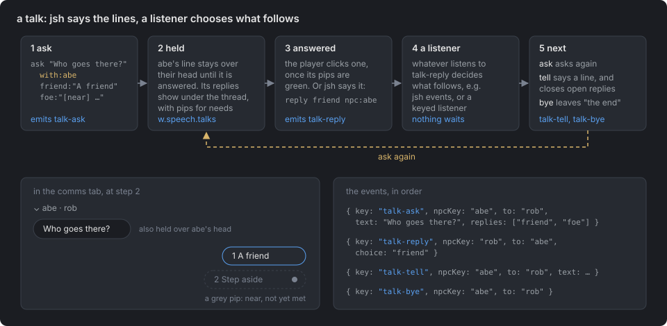
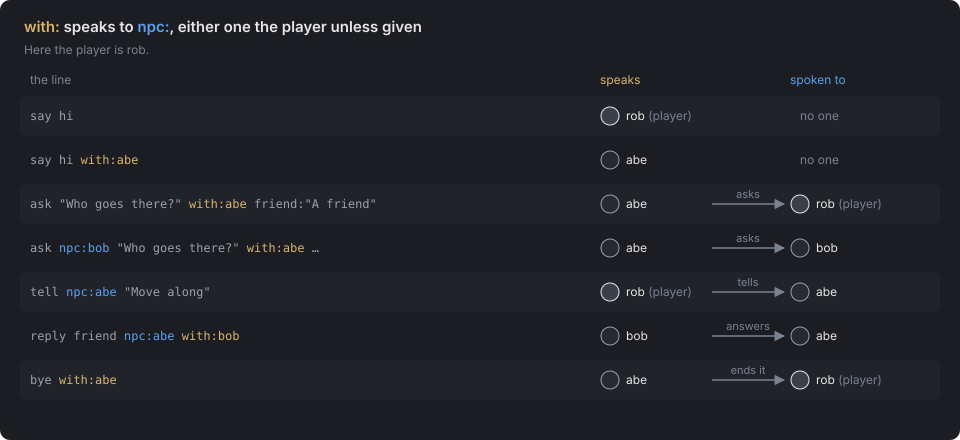
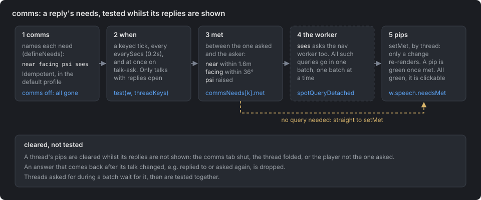

# Speech

What npcs and the player say: the speech history (`WorldSpeech`, `w.speech`), the bubbles over their heads (`NpcBubbles`), and conversations.

A conversation is made on the fly by jsh commands in `cli/src/jsh/world/comms.ts`, one line each. There are no saved trees. Lines are short, at most 8 words, the player's too.

Nothing waits. Each command emits an event, and whatever listens decides what follows, e.g. `events 'x => x.key === "talk-reply"'`, or a keyed listener (`w.e.addKeyedListener`).

The diagrams are in `docs/speech/`, hand-written SVG.

## The commands

`with:` names who speaks, and `npc:` who is spoken to. Either is the player unless given. The bare words are the line.

| Line | Meaning | Emits |
| --- | --- | --- |
| `say hi` / `say hi with:rob` | the player says it, or rob (`npc:` is an alias of `with:` here) | `speech` |
| `ask "Who goes there?" with:abe friend:"A friend" foe:"[near] Step aside"` | abe asks the player | `talk-ask` |
| `ask npc:bob "Who goes there?" with:abe friend:"A friend"` | abe asks bob | `talk-ask` |
| `tell "Move along" with:abe` / `tell npc:abe "Move along"` | abe tells the player, or the player tells abe | `talk-tell` |
| `bye with:abe` / `bye npc:abe` | abe ends the talk with the player, or the player with abe | `talk-bye` |
| `reply friend npc:abe with:bob` | bob answers abe's ask, as a click does for the player | `talk-reply` |

- An `ask`'s other `key:"text"` options are its replies. A leading `[need,…]` gives a reply's needs. `topic:` sets its topic.
- `talk-reply`'s `choice` is the reply's key.
- `reply` fails unless that reply is open to the one replying.
- A line holding a `:` is read as an option.

## Talks: `WorldSpeech`

A talk (`w.speech.talks`, by thread) is its last ask: who asked (`npcKey`), who was asked (`toKey`), and its open `replies` (`TalkChoice`, in `service/talk.ts`).
- The replies close once one is said, or on the next `tell` or `bye` between the two.
- Only the player sees them, under the thread, when they are the one asked. A click says it, once its pips are green.
- `bye` leaves "the end" under the thread until the next ask.
- A talk whose npc is gone keeps its history, and offers nothing.
- Talks are the panel's own state, unsaved.

### The history

`WorldSpeech` is a button, marked when something was said since its history was last open, and that history, grouped into threads by who spoke and to whom (`threadKeyOf`). A plain `w.speech.say` is a thread of one. `say` takes `to`, which the `speech` event carries, so a client's history groups alike.

A thread is drawn by `TalkThread` (`TalkThread.tsx`, styled by `talk-thread.css`): speech bubbles, the player's on the right, an npc's tinted by topic (`topicHue`) with a rule naming each topic turned to. A reply and its answer share a row. Only the latest row and the one before, dimmed, show. The rest fold into an ellipsis until clicked, and a click on the latest folds them again.

A thread may also hold THOUGHTS, an npc's and not said: see `docs/psi.md`.

### Over their heads

Every line said also shows over the speaker's head: ONE click-through bubble per npc (`NpcBubbles`), pinned over them each frame. Their menu (room, pose, items, and for the player `BreathControls`) is a `PickMenu`. It opens on right-click with the debug **context menu** on, or from the speech menu's **debug** (`w.pickMenu.toggle`).

An ask with replies is `hold`: it stays until someone it addresses speaks (`release`), then runs `lineSecsOf` of world time, as any other line does.

A long line is shown a page at a time (`pagesOf`): whole sentences, at most `pageChars` (120) a page, with a counter, e.g. `2/3`. Each page runs its own `lineSecsOf`, and only the last fades. A held line stays on its last page. Pages turn by writing to the DOM from `onTick` (`showPage`), never by a render. The speech history shows the line whole.

## Needs: jsh `comms`

A reply waits on its `needs`, drawn as pips, green once met. A need is only a key to the World:
- `w.speech.defineNeeds({ [key]: { label, icon? } })` names them.
- `w.speech.setMet({ [threadKey]: keys })` says which are met.
- One undefined is never met.

jsh `comms` (in the default profile, idempotent) defines and tests them (`commsNeeds`), between the one asked and the asker:
- `near`: within `commsConfig.nearDist`;
- `facing`: within `facingArc` of straight ahead;
- `psi`: the player's psi raised;
- `sees`: the player sees the npc, as jsh `sees`.

A keyed tick tests the talks whose replies are drawn every `everySecs`, and its listener at once on a `talk-ask`. Their worker queries, e.g. `sees`, go in one batch, one at a time. A thread out of sight, e.g. folded, is cleared. `comms off` removes them.
