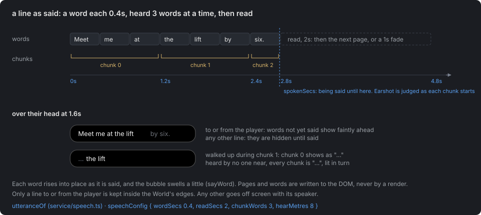
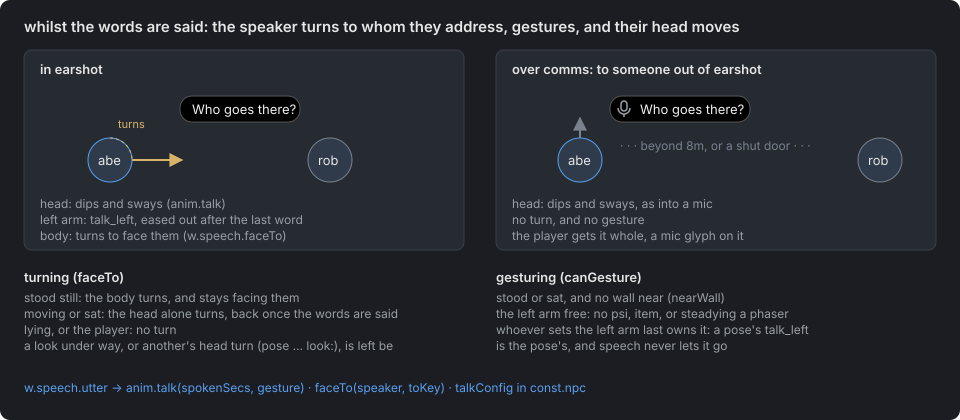
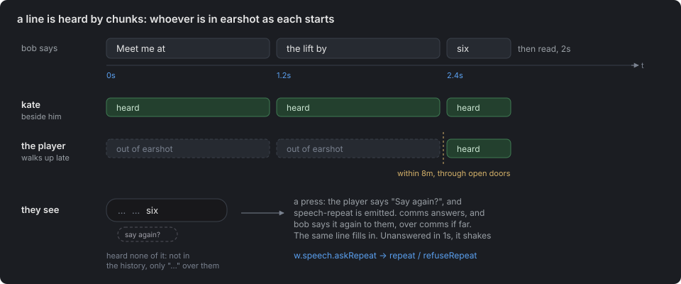
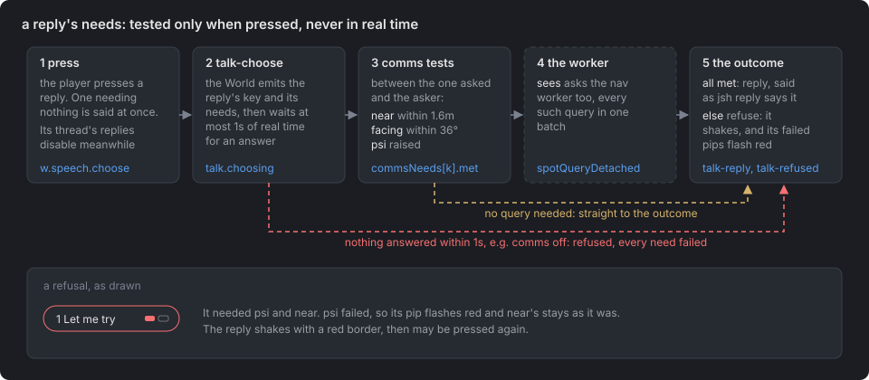
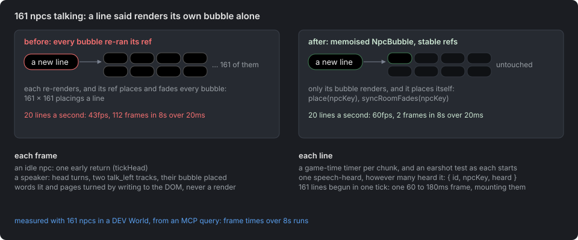

# Speech

What npcs and the player say: the speech history (`WorldSpeech`, `w.speech`), the bubbles over their heads (`NpcBubbles`), and conversations.

A conversation is made on the fly by jsh commands in `cli/src/jsh/world/comms.ts`, one line each. There are no saved trees. Lines are short, at most 8 words, the player's too.

Nothing waits. Each command emits an event, and whatever listens decides what follows, e.g. `events 'x => x.key === "talk-reply"'`, or a keyed listener (`w.e.addKeyedListener`).

The diagrams are in `docs/speech/`, hand-written SVG.

## The commands

`with:` names who speaks, and `npc:` who is spoken to. Either is the player unless given. The bare words are the line.

| Line | Meaning | Emits |
| --- | --- | --- |
| `say hi` / `say hi with:rob` | the player says it, or rob (`npc:` is an alias of `with:` here) | `speech` |
| `ask "Who goes there?" with:abe friend:"A friend" foe:"[near] Step aside"` | abe asks the player | `talk-ask` |
| `ask npc:bob "Who goes there?" with:abe friend:"A friend"` | abe asks bob | `talk-ask` |
| `tell "Move along" with:abe` / `tell npc:abe "Move along"` | abe tells the player, or the player tells abe | `talk-tell` |
| `bye with:abe` / `bye npc:abe` | abe ends the talk with the player, or the player with abe | `talk-bye` |
| `reply friend to:abe` / `reply friend npc:abe with:bob` | the player answers abe's ask, or bob does, as a click does for the player (`to:` is an alias of `npc:`) | `talk-reply` |

- An `ask`'s other `key:"text"` options are its replies. A leading `[need,…]` gives a reply's needs. `topic:` sets its topic.
- `talk-reply`'s `choice` is the reply's key.
- `reply` fails unless that reply is open to the one replying.
- An unquoted word holding a `:` is read as an option. A quoted line may hold one.

## Talks: `WorldSpeech`

A talk (`w.speech.talks`, by thread) is its last ask: who asked (`npcKey`), who was asked (`toKey`), and its open `replies` (`TalkChoice`, in `service/talk.ts`).
- The replies close once one is said, or on the next `tell` or `bye` between the two.
- Only the player sees them, under the thread, when they are the one asked. A click says it, once its needs pass (below).
- `bye` leaves "the end" under the thread until the next ask.
- A talk whose npc is gone keeps its history, and offers nothing.
- Talks are the panel's own state, unsaved.

### The history

`WorldSpeech` is a button, marked when something was said since its history was last open, and that history, grouped into threads by who spoke and to whom (`threadKeyOf`). A plain `w.speech.say` is a thread of one. `say` takes `to`, which the `speech` event carries, so a client's history groups alike.

A thread is drawn by `TalkThread` (`TalkThread.tsx`, styled by `talk-thread.css`): speech bubbles, the player's on the right, an npc's tinted by topic (`topicHue`) with a rule naming each topic turned to. A reply and its answer share a row. Only the latest row and the one before, dimmed, show. The rest fold into an ellipsis until clicked, and a click on the latest folds them again.

A thread may also hold THOUGHTS, an npc's and not said: see `docs/psi.md`.

### Over their heads

Every line said also shows over the speaker's head: ONE click-through bubble per npc (`NpcBubbles`), pinned over them each frame. Their menu (room, pose, items, and for the player `BreathControls`) is a `PickMenu`. It opens on right-click with the debug **context menu** on, or from the speech menu's **debug** (`w.pickMenu.toggle`).

An ask with replies is `hold`: it stays until someone it addresses speaks (`release`), then runs its last page's `pageSecs` of game time, as any other line does.

A long line is shown a page at a time: whole sentences, at most `pageChars` (120) a page, with a counter, e.g. `2/3`. Only the last page fades. A held line stays on its last page.

Its timing is `utteranceOf` (`service/speech.ts`), shared with hearing (below):
- Each word takes `speechConfig.wordSecs` (0.4s) to say. A page then stays `readSecs` (2s) to be read (`pageSecs`).
- Each word shows as it is said, rising into place. Words not yet said are faint for the player's lines, else hidden.
- The bubble swells a little with each word (`sayWord`).
- All of it is written to the DOM from `onTick` (`showPage`, `sayWord`), never by a render.
- Each npc's bubble is a memoised `NpcBubble` with stable refs, so a line said renders its own bubble alone.

Only a bubble for the player, i.e. to or from them, is kept inside the World's edges, as is a thought. Any other goes off screen with its speaker.

### The speaker

`w.speech.utter` sets them going as a line starts, and a line cut off stops them.
- **Head.** Whilst the words are being said it dips and sways, over whatever pose they are in: stood, sat, lain or aiming (`anim.talk`, `talkConfig`).
- **Left arm.** It talks too (`talk_left`), stood or sat, whilst it is free and no wall is near (`anim.canGesture`), and eases out after the last word. Whoever sets the left arm last owns it, so a jsh `pose … as:talk_left` keeps it.
- **Turning.** They turn to whom they speak to (`w.speech.faceTo`). Stood still, their body turns and stays so, unless a look is under way. Else only their head turns, back once the words are said. The player is not turned, nor one lying.
- **Over comms.** Said to someone out of earshot, the line goes into a mic: the head moves, but they neither turn nor gesture.

## Hearing

A line is heard a chunk at a time, `chunkWords` (3) words to a chunk, by whoever is in earshot as that chunk starts. Earshot is the speaker's room and those through open doors (`w.npc.near.inReach`), within `hearMetres` (8m) (`w.speech.hearersOf`).
- **Timing.** `w.speech.utter` sets a game-time timer per chunk (`w.e.after`), so hearing pauses with the World and nothing is polled.
- **Partial.** Someone who walks up mid-line hears the rest, and someone who walks off misses it.
- **Cut off.** A new line from the same speaker cuts off the last, and what was left unsaid is unheard.
- **The player.** A line to or from the player always reaches them whole. Out of their earshot it comes over comms: a mic glyph in the bubble and the history (`entry.via`).
- **Recorded.** Each line keeps its `chunks`, how many are `said`, and who `heard` which. Once said, it emits one `speech-heard { id, npcKey, heard }`, the chunks each heard by npcKey, so a listener can act on what was overheard.

The player sees only what they heard:
- A line they heard none of is not in the history, nor does it mark it unread. Talk is found by coming within earshot of it.
- A missed chunk is "…" over the speaker's head (`w.bubble.missChunk`), and in the history once they heard some of the line.
- Under a line missed in part, the history offers **say again?** (`w.speech.askRepeat`), as a pip is tested on a press:
  1. The player says "Say again?" to the speaker, and the World emits `speech-repeat` (`id`).
  2. Whatever listens calls `w.speech.repeat(id)`, and the speaker says the line again to the player, filling in the gaps of the same entry. Or it calls `refuseRepeat(id)`, and the press shakes.
  3. Unanswered within `chooseTimeoutMs` (1s), it is refused.
- jsh `comms` always says it again, as yet.

A net client judges hearing for its own player, as it runs the same `say` on each line it is sent.

## Needs: jsh `comms`

A reply's `needs` are drawn as pips, and tested only when the player presses it, never in real time. A need is only a key to the World. `w.speech.defineNeeds({ [key]: { label, icon? } })` names them, for the pips.

A press (`w.speech.choose`) of a reply with no needs says it at once. Otherwise:
1. The World emits `talk-choose` (`choice`, `needs`) and disables the thread's replies (`talk.choosing`).
2. Whatever listens tests the needs, then calls `w.speech.reply` to say it, or `w.speech.refuse(threadKey, choice, failed)`.
3. Refused, it emits `talk-refused` (`failed`). The reply shakes with a red border, and its failed pips flash red (`talk.refused`).
4. Unanswered within `chooseTimeoutMs` (1s, real time), it is refused with every need failed, e.g. with `comms` off.

jsh `comms` (in the default profile, idempotent) defines the needs (`commsNeeds`) and listens for `talk-choose`. It tests them between the one asked and the asker:
- `near`: within `commsConfig.nearDist`;
- `facing`: within `facingArc` of straight ahead;
- `psi`: the player's psi raised;
- `sees`: the player sees the npc, as jsh `sees`. It asks the worker, its queries in one batch.

An unknown need fails. `comms off` removes them. jsh `reply` says a reply without testing it.

## Cost

Measured with 161 npcs in a DEV World, from an MCP `query`:
- **Idle npcs** cost one early return a frame (`tickHead`). Nothing iterates them.
- **Staggered talk**, 20 lines a second: 60fps, p99 16.8ms. Before bubbles were memoised it was 43fps: each line re-ran every bubble's ref, which placed and faded every bubble.
- **All 161 starting in one tick** costs one 60 to 180ms frame: mounting their word spans and starting their turns. A scene does not do this.
- **Per speaker** a frame: a few quaternion turns of the head, two sampled `talk_left` tracks, and their bubble's placing.
- **Per chunk**, about every 1.2s a speaker: one earshot test (`hearersOf`), a walk of the room graph.
- **Per line**: a timer per chunk (`w.e.after`), and one `speech-heard` however many heard it.

